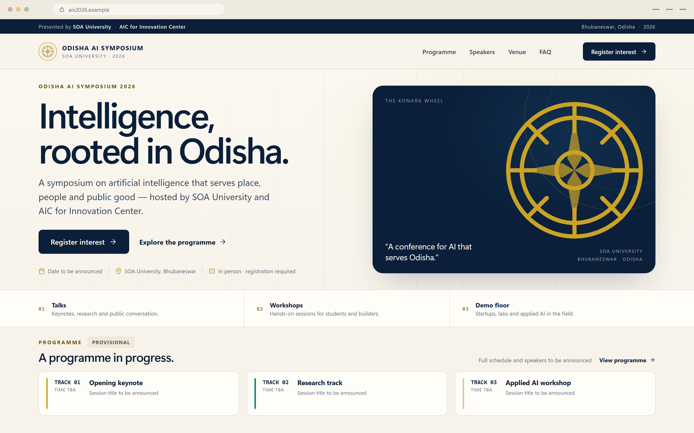
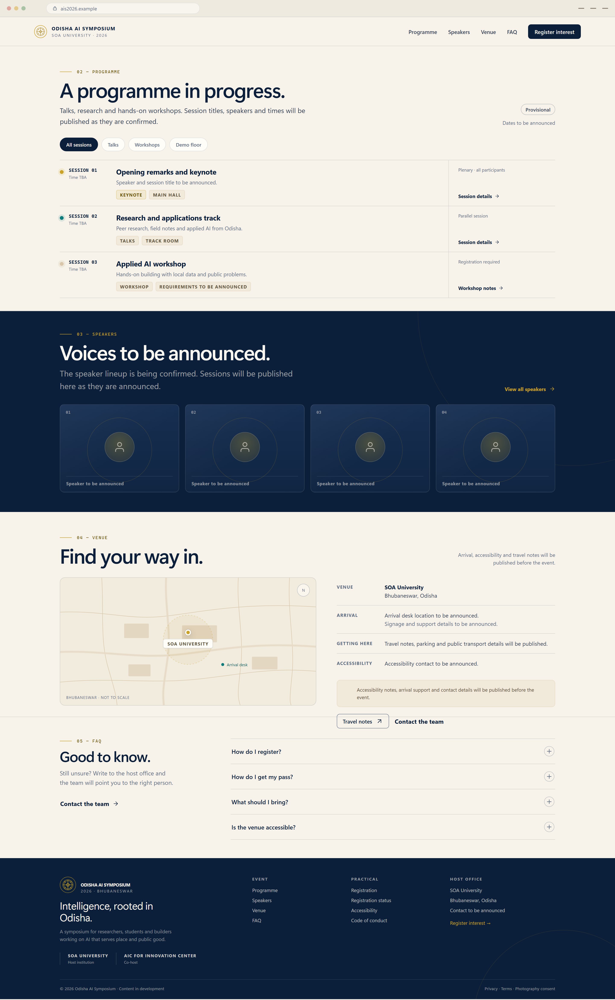
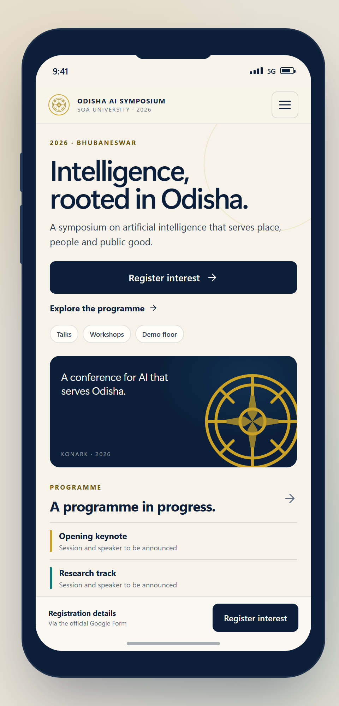
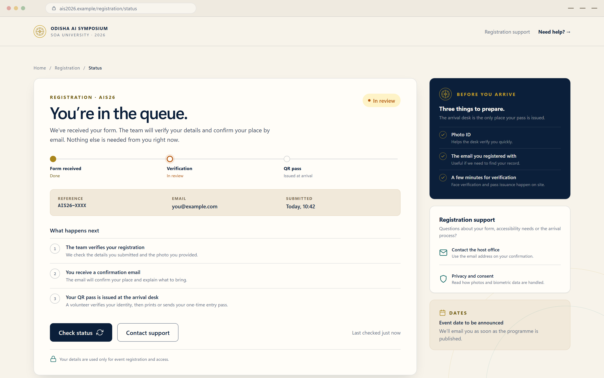
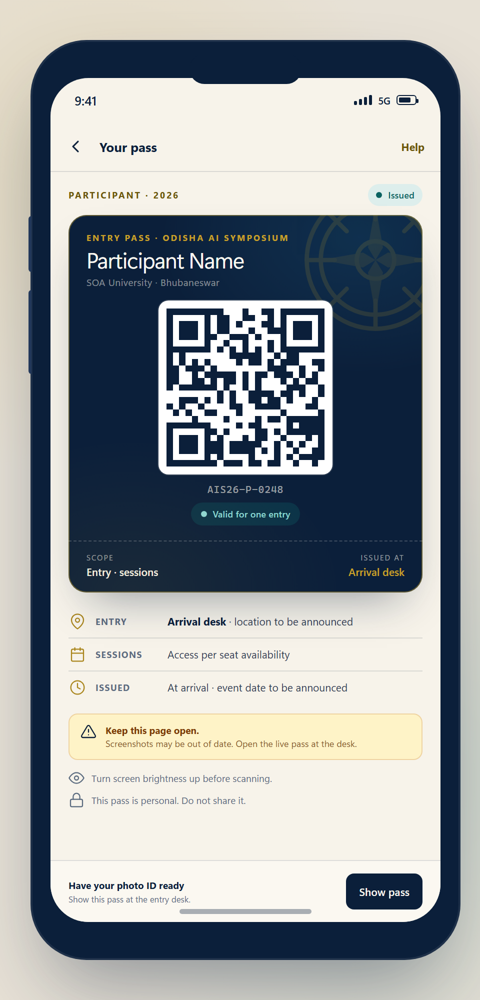
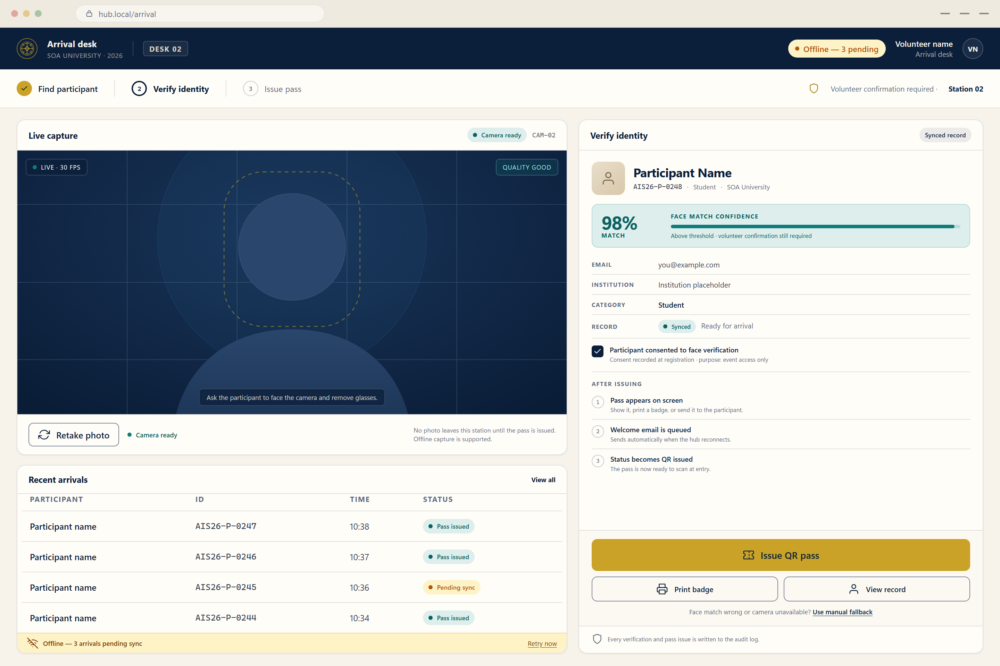
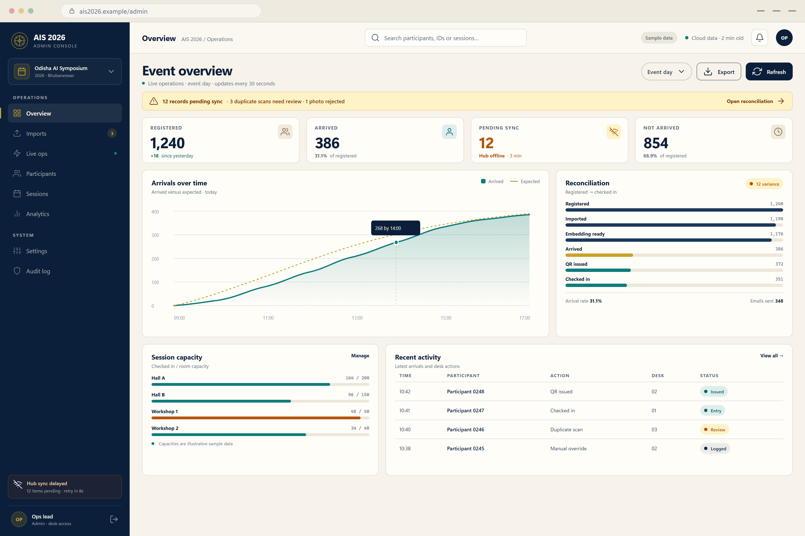
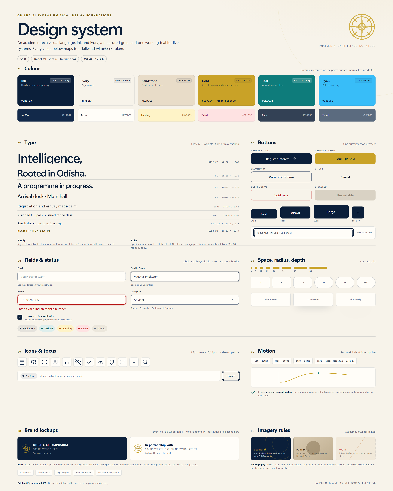

# Frontend Planning — Odisha AI Symposium 2026

**Product:** GeekAI registration, arrival, ticketing and check-in  
**Hosts:** SOA University · AIC for Innovation Center  
**Document type:** Implementation-ready frontend redesign plan  
**Version:** 1.0 · 19 November 2026  
**Scope:** Frontend only. Backend, database, Docker, infrastructure and deployment are explicitly out of scope.  
**Source of truth:** [`WorkFlow.md`](WorkFlow.md) — where this document and the workflow disagree, the workflow wins.  
**Design renders:** [`frontend/design/mockups/`](frontend/design/mockups/) · **Source:** [`frontend/design/mockup-src/`](frontend/design/mockup-src/)

---

## Contents

1. [Executive summary and design principles](#1-executive-summary-and-design-principles)
2. [Research synthesis](#2-research-synthesis)
3. [Current-state audit](#3-current-state-audit)
4. [Brand and art direction](#4-brand-and-art-direction)
5. [Design system](#5-design-system)
6. [Information architecture and navigation](#6-information-architecture-and-navigation)
7. [Page-by-page specifications](#7-page-by-page-specifications)
8. [Responsive strategy](#8-responsive-strategy)
9. [Accessibility](#9-accessibility)
10. [Performance](#10-performance)
11. [Phased file-level roadmap](#11-phased-file-level-roadmap)
12. [QA checklist and acceptance criteria](#12-qa-checklist-and-acceptance-criteria)
13. [Mockup gallery](#13-mockup-gallery)
14. [Open questions and assets needed](#14-open-questions-and-assets-needed)

---

## 1. Executive summary and design principles

### 1.1 The problem this redesign solves

The current frontend was built for a conventional “register online, receive a QR by email, scan at the door” event. The actual event model in `WorkFlow.md` is different and stricter:

1. Registration happens through the **in-site React form** at `/register`, not an external service.
2. The participant is **verified in person at an arrival desk**.
3. A **signed, event-scoped QR pass is issued only after arrival**.
4. Entry is a **one-time** QR scan; session scans are separate.
5. The venue may lose internet; a **local hub** keeps arrival and check-in working, then syncs.
6. Every state is auditable and reconcilable: `IMPORTED → PHOTO_VALIDATED → EMBEDDING_READY → SYNCED → ARRIVED → QR_ISSUED → CHECKED_IN`.

The current UI contradicts that model in visible, damaging ways: the home page promises a QR by email, the registration success screen says the QR has been sent, and the arrival screen marks someone present without ever issuing a pass. Those are not copy bugs; they are trust failures at the most important moment of the event.

This plan replaces the public-facing “app” with a **calm event site**, a **participant pass**, a **volunteer arrival console**, and an **operations dashboard** that match the real workflow. It keeps the existing React 19 + Vite 6 + Tailwind v4 stack, respects the current backend contracts where they exist, flags the new endpoints the workflow requires, and sequences the work so the event-critical flow ships first.

### 1.2 Design direction in five bullets

- **Academic-tech, not AI-startup theatre.** Deep ink navy and warm ivory, one measured gold, one working teal. No neon, no glassmorphism, no robot brains, no circuit-board decoration.
- **The Konark wheel is geometry, not clipart.** One large line-drawn wheel per view, at 8–14% opacity or as a single hero object. It structures the page; it does not illustrate “Indian heritage.”
- **Facts before adjectives.** Date, venue, host, registration status and what happens next are visible before any mission statement.
- **One job per screen.** Public: decide to register. Status: know what happens next. Ticket: present a pass. Arrival: verify, then issue. Scanner: one clear result. Admin: spot and fix variance.
- **Designed for the desk.** 44 px targets, high contrast, offline banners, print fallbacks, and no interaction that depends on perfect venue Wi-Fi.

### 1.3 What success looks like

| Measure | Target | Source |
|---|---|---|
| Arrival throughput | 95% of arrivals completed in under 30 seconds | `WorkFlow.md` §14 |
| QR verification | 99% of scans under 2 seconds | `WorkFlow.md` §14 |
| Welcome email | >95% delivered within 5 minutes of QR issuance | `WorkFlow.md` §14 |
| Duplicate check-ins | Zero | `WorkFlow.md` §14 |
| Offline tolerance | 2-hour internet outage, zero data loss | `WorkFlow.md` §14 |
| Reconciliation | Zero unexplained variance between hub and cloud | `WorkFlow.md` §14 |
| Accessibility | WCAG 2.2 AA; no critical axe findings | This document §9 |
| Performance | LCP < 2.0 s on 4G; INP < 200 ms; CLS ≤ 0.05 | This document §10 |

### 1.4 Principles, with consequences

**1. Tell the truth about state.**  
If a pass has not been issued, say “Issued at the arrival desk.” If the hub is offline, say “Offline — 3 pending.” If data is two minutes old, say “Synced 2 min ago.” Never use a success state to paper over an asynchronous process.

**2. Design the exception first.**  
Camera denied. Face match low confidence. Already checked in. Duplicate scan. Wrong event scope. Printer offline. Hub offline. Expired token. These are the screens volunteers will remember. They get first-class layouts, not toast errors.

**3. Calm is a feature.**  
The event is dense and noisy. The interface should lower the temperature: generous spacing, one primary action, short sentences, no confetti, no emoji, no animated gradients. Ceremony is carried by the gold rule and the Konark line, not by decoration on every card.

**4. Institutional confidence, human warmth.**  
The visual language should feel like a serious university symposium that a student is glad to attend — not a government portal and not a growth-hacked SaaS launch. Plain English, real labels, no jargon like “biometric identity orchestration.”

**5. Build for the worst device in the room.**  
A volunteer may use a mid-range Android phone on 4G, indoors, with the screen at 30% brightness. A participant may screenshot the pass. An admin may open the dashboard on a 1366×768 laptop. Every layout must work there before it works on a 4K monitor.

### 1.5 Scope and non-goals

**In scope:** public site, in-site registration form, registration status, participant ticket, volunteer arrival, QR scanner, manual lookup, admin shell, dashboard, imports, participants, sessions, attendance, reconciliation, audit, login, global states, print styles, design tokens, component inventory, responsive and accessibility rules, performance budgets, file-level roadmap, QA.

**Out of scope:** API implementation, database schema, S3/Cloudflare/AWS configuration, third-party form construction, email templates, face-matching model tuning, native apps, payments, multi-event support, certificates (post-event phase), Odia/Hindi translation (strings should be ready for it, but translation is not delivered here).

**Explicitly not doing:** a full rewrite of the app, a new state-management library, a dark-mode theme for the public site, Framer Motion in v1, Recharts in v1, a CMS, a native mobile app, or a custom design system package. The plan favours a small number of well-made primitives over a large component library.

---

## 2. Research synthesis

### 2.1 Method

Fourteen public sites were reviewed in November 2026 across four buckets: AI/tech conferences, premium events, university/research institutions, and craft benchmarks. The goal was not to copy layouts but to extract repeatable decisions about hierarchy, programme presentation, institutional trust, and interaction quality.

The table records what works, what is worth adapting, and what to avoid at this scale. Observations are design notes, not endorsements or audits of the organisations.

### 2.2 The fourteen references

| # | Site | Bucket | What works | What to adapt | What to avoid |
|---|---|---|---|---|---|
| 1 | [NeurIPS 2026](https://neurips.cc/) | AI/tech conference | Date, venue and primary CTA are factual and immediate; dated announcements keep the page alive; programme is scannable | A fact strip under the hero; dated news; one clear registration CTA | Dense paragraphs and very small type on mobile |
| 2 | [Google I/O 2025](https://io.google/) | AI/tech conference | Focus-area tiles make a large programme feel navigable; recap content extends the event’s life; registration path is obvious | Tile-based programme entry points; session tracks; post-event recap block | Gradient-heavy hero that lowers text contrast and makes every section compete |
| 3 | [NVIDIA GTC](https://www.nvidia.com/gtc/) | AI/tech conference | Theme-led hero; speaker grid; schedule filters; strong sense of scale | Speaker cards linked to sessions; filtered programme; theme statement | Video-first hero and a dark-only palette that is hard to read in a bright hall |
| 4 | [AWS re:Invent 2026](https://reinvent.awsevents.com/) | AI/tech conference | Session catalog, venue wayfinding, and “plan your day” utilities; the nav supports a very large event | Catalog filters; venue/arrival content as first-class pages | Mega-menu overload for a single-track symposium |
| 5 | [Web Summit](https://websummit.com/) | Premium events | Persistent ticket CTA; speaker marquee; partner proof; the commercial action is never far away | Sticky “Register interest” CTA on mobile; partner strip with context | Autoplay carousels and logo walls without explanation |
| 6 | [Slush 2026](https://slush.org/) | Premium events | Editorial typography; audience segmentation; a strong, coherent art direction | Large display type; explicit audience paths (“student / founder / researcher”) | Cryptic art that hides the basic offer (what, when, where) |
| 7 | [TED](https://www.ted.com/) | Premium events | Talk cards with duration and topic; a content library that works after the event; transcripts | Session/talk cards; topic filters; “watch later” content blocks | Content sprawl and too many competing CTAs on one screen |
| 8 | [MIT Media Lab](https://www.media.mit.edu/) | University/research | Research-first cards; a quiet grid; project pages that lead with the work | Project/research card pattern; plain-language summaries | Academic jargon without a one-line explanation |
| 9 | [Stanford HAI](https://hai.stanford.edu/) | University/research | Restrained institutional layout; publications and events are easy to find; quiet hierarchy | Resource lists; institutional header; calm spacing | Dry density and PDF-first navigation |
| 10 | [SOA University](https://www.soa.ac.in/) | University/research | Quick links and announcements; institutional trust is immediate | Utility quick links; host credibility block; admission/help patterns | Outdated carousels and PDF-first content |
| 11 | [AIC-SOA Foundation](https://aicsoa.org/) | University/research | Programme, startup and event sections; ecosystem framing | Programme blocks; “host + innovation centre” co-brand lockup | Generic stock imagery and unclear next steps |
| 12 | [Linear](https://linear.app/) | Craft benchmark | Dark product storytelling; precise UI; confident type; motion that explains hierarchy | Product-grade detail; restrained transitions; screenshot discipline | Dark mode for long-form reading; motion that delays the task |
| 13 | [Stripe](https://stripe.com/) | Craft benchmark | Restrained type; customer proof; generous spacing; gradients used as accents | Proof blocks; spacing rhythm; one accent per section | Gradient overuse and decorative complexity |
| 14 | [Vercel](https://vercel.com/) | Craft benchmark | Modular dark blocks; strong typography; clear product CTAs | Modular section rhythm; crisp labels | All-dark sameness and low-contrast grey text |

### 2.3 What the references agree on

1. **Put the facts first.** The strongest event sites answer *what, when, where, how do I register* before they explain why the event matters.
2. **Make the programme a data structure, not a poster.** Rows with time, track, title, speaker and action scale; a PDF poster does not.
3. **Keep one commercial action visible.** Register, apply or buy — repeated at natural intervals, not every 200 px.
4. **Institutional trust is visual.** Restrained type, generous space, real names and real affiliations beat decorative “innovation” imagery.
5. **Craft is consistency.** The best sites repeat the same spacing, type scale and interaction rules until the whole page feels inevitable.

### 2.4 What this means for AIS 2026

- **Hero:** a split layout with facts at the bottom and one primary CTA. The right side is a single Konark object, not a photo carousel.
- **Programme:** a filterable row list, not three generic cards. Every row says “Session title to be announced” until the programme is real.
- **Speakers:** placeholder cards are explicitly labelled. No stock faces, no invented names.
- **Venue:** practical arrival, transport and accessibility information, with a clearly marked “to be announced” state.
- **Registration:** an in-site React form that captures details, photo and consent, validates them, and explains that the pass is issued at arrival.
- **Admin:** product-grade data density with a clear freshness indicator, not a wall of stat cards.
- **Motion:** short, purposeful, and never on the QR, camera or biometric result.

### 2.5 What we reject

- Neon gradients, “AI brain” illustrations, robot heads, circuit-board patterns, and purple-blue SaaS lighting.
- Glassmorphism cards over photography.
- Autoplay video heroes and carousels that hide the date and venue.
- Logo walls with no explanation of the relationship.
- “Revolutionary,” “cutting-edge,” “unleash,” “seamless,” “game-changing.”
- Fake urgency (“Only 3 seats left!”) without a real capacity source.
- QR codes rendered as decoration rather than as a verified, signed payload.

---

## 3. Current-state audit

### 3.1 Method and limits

All frontend source files were read statically: 32 files under `frontend/src`, plus `index.html`, `index.css`, `package.json`, `vite.config.js`, `README.md` and `WorkFlow.md`. The app was not run in a browser for this audit, so performance figures in this document are **budgets**, not measurements. Findings are based on code paths, copy and component structure.

### 3.2 Stack and structure

| Area | Current | Implication |
|---|---|---|
| Framework | React 19.1, Vite 6.3.5 | Keep. No framework migration needed. |
| Styling | Tailwind CSS 4.1.7 via `@tailwindcss/vite`, CSS-first `@theme` in `src/index.css` | Keep. Extend tokens; do not add `tailwind.config.js`. |
| Routing | React Router DOM 7.6.1 | Keep. Add route-level lazy loading and a real 404. |
| Data | TanStack Query 5.75, axios 1.9 | Keep. Add error normalization, freshness and retry policy. |
| UI icons | lucide-react 0.511 | Keep. `react-icons` is installed but unused. |
| Camera/QR | html5-qrcode 2.3.8 | Keep for v1; isolate it to the scanner route. |
| Notifications | react-hot-toast 2.5.2 | Keep, but reserve toasts for transient confirmations; not for primary results. |
| Dates | date-fns 4.1 | Keep. Render in `Asia/Kolkata`. |
| Tests / lint | None | Add a minimal test and lint baseline in Phase 0. |

### 3.3 Route inventory

| Route | Page | Audience | Status |
|---|---|---|---|
| `/` | `Home.jsx` | Public | Exists; generic hero and misleading copy |
| `/register` | `Register.jsx` | Public | Exists; legacy handoff contradicts the in-site form decision |
| `/login` | `Login.jsx` | Staff | Exists; combined login |
| `/admin/login` | `Login.jsx` | Admin | Duplicate of `/login` |
| `/volunteer/login` | `Login.jsx` | Volunteer | Duplicate of `/login` |
| `/admin/dashboard` | `Dashboard.jsx` | Admin | Exists; four stat cards only |
| `/admin/participants` | `Participants.jsx` | Admin | Exists |
| `/admin/participants/:id` | `ParticipantDetail.jsx` | Admin | Exists |
| `/admin/sessions` | `Sessions.jsx` | Admin | Exists |
| `/admin/attendance` | `Attendance.jsx` | Admin | Exists |
| `/admin/volunteers` | `Volunteers.jsx` | Admin | Exists |
| `/admin/export` | `Export.jsx` | Admin | Exists |
| `/volunteer/dashboard` | `VolunteerDashboard.jsx` | Volunteer | Exists; card menu |
| `/volunteer/face-checkin` | `FaceCheckIn.jsx` | Volunteer | Exists; no QR issuance |
| `/volunteer/scan` | `QRScanner.jsx` | Volunteer | Exists; trusts unsigned client JSON |
| `/volunteer/manual` | `ManualLookup.jsx` | Volunteer | Exists |
| `*` | Redirect to `/` | Everyone | Missing 404 |

**Missing routes for the target model:** public programme/speakers/venue/FAQ, registration status, participant ticket, privacy/accessibility, volunteer arrival/queue/help, admin imports/import detail/live ops/reconciliation/audit/settings, 403, 500, offline.

### 3.4 Prioritised problems

#### P0 — blocks event correctness or trust

| # | Problem | Evidence | Impact | Fix |
|---|---|---|---|---|
| P0-1 | The QR scanner trusts client-parsed JSON and sends `participant_id` + `name` to `/attendance/validate-qr` | `frontend/src/pages/volunteer/QRScanner.jsx:70-87` | A forged QR can impersonate a participant; violates the signed-token model in `WorkFlow.md` Appendix B | Verify signature, `jti`, scope, event and expiry on the hub/API; the client only displays the result. Render signed tokens, never plain JSON. |
| P0-2 | The arrival flow never issues a QR pass; it marks the participant present directly | `frontend/src/pages/volunteer/FaceCheckIn.jsx:144-167` | Skips `ARRIVED → QR_ISSUED → CHECKED_IN`; participants leave the desk without a pass | Make “Verify identity” and “Issue QR pass” two explicit steps; mark arrival, then issue, then allow entry scan |
| P0-3 | The public native form is still the primary registration path and claims a QR was emailed | `frontend/src/pages/Register.jsx:29-58`, `:60-78` | Contradicts the in-site form decision and the “QR issued at arrival” rule; creates support tickets and no-shows | Rebuild `/register` as the primary in-site React form; keep assisted walk-in on `/register/assisted`; never claim a QR was emailed |
| P0-4 | No participant status or ticket page | `frontend/src/App.jsx:20-67` | Participants cannot check whether they are confirmed, what to bring, or where their pass comes from | Add `/registration/status` and `/ticket/:token` with explicit states |
| P0-5 | No admin imports, live ops or reconciliation screens | `frontend/src/App.jsx:40-47` | Operators cannot review registration submissions, watch arrivals, or resolve hub/cloud variance | Add `/admin/imports`, `/admin/imports/:id`, `/admin/live`, `/admin/reconciliation` |
| P0-6 | No offline/sync state in the UI | `AdminLayout.jsx`, `Dashboard.jsx`, `FaceCheckIn.jsx` | The core promise — a local hub that survives an outage — is invisible; volunteers cannot tell what is pending | Add global sync status, per-desk offline banner, pending queue, retry and last-synced timestamps |
| P0-7 | Wildcard route silently redirects to `/` | `frontend/src/App.jsx:66` | Broken links look like the home page; analytics and support lose the failure | Add a real 404 with recovery links |

#### P1 — usability, accessibility and operational quality

| # | Problem | Evidence | Impact | Fix |
|---|---|---|---|---|
| P1-1 | Admin mobile nav is a horizontally scrolling row of six icon+label items | `frontend/src/components/AdminLayout.jsx:86-103` | Items disappear off-screen; targets are cramped; no “more” affordance | Bottom nav with 4 primary items + “More” sheet; or a drawer |
| P1-2 | Tables use `overflow-x-auto` and `whitespace-nowrap` only | `frontend/src/components/ui/Table.jsx:21`, `:45` | Horizontal scrolling on phones; key columns off-screen | Table-to-card pattern below `md`; keep overflow only as a fallback |
| P1-3 | `Input` label has no `htmlFor` and the input has no `id` | `frontend/src/components/ui/Input.jsx:10`, `:18-31` | Clicking the label does not focus the field; screen readers lose the association | Generate an id with `useId`; wire `htmlFor`, `aria-describedby`, `aria-invalid` |
| P1-4 | `Modal` has no `role="dialog"`, `aria-modal`, focus trap, Esc handling or focus return | `frontend/src/components/ui/Modal.jsx:26-48` | Keyboard and screen-reader users can tab behind the dialog | Use a dialog primitive with labelled title, focus trap, Esc, scroll lock and restore |
| P1-5 | Dashboard is four stat cards plus a category badge list; no arrivals chart, freshness or error state | `frontend/src/pages/admin/Dashboard.jsx:26-31`, `:34-47` | Operators cannot see throughput, variance or whether data is stale | Rebuild as an ops overview: KPIs, arrivals chart, funnel, capacity, activity, freshness |
| P1-6 | Auth stores only `{role, name}` and a token; no `sub`, `exp` or refresh | `frontend/src/context/AuthContext.jsx:20-24` | Cannot expire a session cleanly or identify the actor for audit | Decode/validate `exp`; store minimal claims; add session-expiry UX |
| P1-7 | A 401 hard-redirects with `window.location.href` | `frontend/src/api/client.js:30-35` | Loses the current route and can loop on public pages | Central auth event; redirect with `returnTo`; exempt login/ticket endpoints |
| P1-8 | No biometric consent, accessibility needs, privacy copy or refusal path | `frontend/src/pages/Register.jsx:87-149` | Legal/ethical gap; participants cannot make an informed choice | Add consent version/timestamp, purpose limitation, retention summary, manual-ID fallback |
| P1-9 | Camera effect depends on `[activeTab]` only, while `startCamera`/`stopCamera` depend on `stream` | `frontend/src/pages/volunteer/FaceCheckIn.jsx:44-82` | Stale closures can leave the camera on or restart it unexpectedly | Use a single media hook with explicit start/stop, track cleanup and permission state |
| P1-10 | Scanner requires a session before any scan, including event entry | `frontend/src/pages/volunteer/QRScanner.jsx:26-30` | Volunteers cannot perform the one-time entry scan without a session | Add a mode switch: Entry (default) / Session; session select only for session mode |
| P1-11 | Result states are small cards with emoji and low-contrast borders | `frontend/src/pages/volunteer/QRScanner.jsx:193-239` | A queue of people cannot read the result at a glance | Full-width, high-contrast result panel with icon, label, name, reason, next action |
| P1-12 | Gold text on ivory is used for eyebrows and small labels at 3.13:1 | `frontend/src/pages/Home.jsx:17-19` (accent text), design tokens | Fails WCAG AA for normal text | Use `#6B5508` (gold-700) for text on light; reserve `#C9A227` for large graphics and dark surfaces |

#### P2 — polish and maintainability

| # | Problem | Evidence | Impact | Fix |
|---|---|---|---|---|
| P2-1 | `index.html` links `/vite.svg`; there is no `public/` directory | `frontend/index.html:5` | 404 favicon; unbranded browser tab | Add `public/favicon.svg`, `og-image.png`, theme-color, description |
| P2-2 | No meta description, Open Graph, Twitter card or canonical | `frontend/index.html:3-8` | Poor sharing and search previews | Add static meta; keep OG image 1200×630 |
| P2-3 | Inter is declared but never loaded | `frontend/src/index.css:14` | Falls back to system fonts; inconsistent metrics | Self-host Inter Variable, preload, `font-display: swap` |
| P2-4 | Only six colour tokens; no type, spacing, radius, shadow or motion tokens | `frontend/src/index.css:3-10` | Ad-hoc Tailwind classes and drift | Replace with the token set in §5 |
| P2-5 | Generic AI hero, `Brain` icon, three feature cards, emoji success | `Home.jsx:8-35`, `Register.jsx:65` | Looks like a hackathon project, not a university symposium | New art direction and copy deck (§4, §7) |
| P2-6 | Category/method colours are ad-hoc Tailwind palettes | `frontend/src/utils/helpers.js:30-47` | Inconsistent semantics; some combinations fail contrast | Semantic status map in one module |
| P2-7 | `react-icons` is installed but unused | `frontend/package.json:18` | Dead dependency | Remove after confirming no imports |
| P2-8 | No 404, error boundary, empty-state or skeleton system | `App.jsx`, page components | Blank screens and inconsistent loading | Add global state components (§7.9) |
| P2-9 | No print styles for badges or tickets | `frontend/src/index.css` | The desk cannot print a fallback pass | Add print CSS and a badge template (§8.7) |
| P2-10 | No tests, lint or formatting baseline | `frontend/package.json:6-9` | Regressions are likely during the redesign | Add Vitest, Testing Library, axe, ESLint, Prettier in Phase 0 |

### 3.5 What is worth keeping

- **Role-based route guards.** `ProtectedRoute` and the admin/volunteer split are the right shape; they need better session semantics, not replacement.
- **TanStack Query.** Caching, retries and loading states are already available; the redesign should use them consistently instead of bespoke `useEffect` fetches.
- **Small, readable components.** The primitives are thin; they can be upgraded in place rather than replaced by a library.
- **Lucide.** Consistent stroke icons, tree-shaken, already installed.
- **The existing data contracts.** `Attendance`, `Participants`, `Sessions` and `Export` pages prove the API shape; keep the endpoints and improve the presentation.
- **The volunteer/Admin split.** The information architecture is sound; the arrival flow needs a new step, not a new app.

### 3.6 Audit conclusion

The backend and workflow are ahead of the frontend. The frontend currently tells a simpler, older story: “register, get a QR, walk in.” The redesign’s main job is to make the real, more complex story feel simple — and to make the exception states visible before they become event-day incidents.

---

## 4. Brand and art direction

### 4.1 Positioning

**A working symposium for AI that serves place, people and public good — hosted in Bhubaneswar by SOA University and AIC for Innovation Center.**

The visual register is **academic-tech**: the confidence of a university press, the clarity of a well-made product, and the material warmth of Odisha. It should feel at home next to a research poster and a printed programme, not next to a crypto launch.

**Working line:** “Intelligence, rooted in Odisha.”  
**Supporting line:** “A symposium on artificial intelligence that serves place, people and public good.”  
**Copy status:** working copy; needs host approval before launch. No date, speaker or attendance claim is implied.

### 4.2 Voice

| Do | Don't |
|---|---|
| “Your pass is issued at the arrival desk.” | “Your personalised QR code is on its way!” |
| “We check the photo and details you submitted.” | “AI instantly verifies you.” |
| “Offline — 3 arrivals pending sync.” | “Everything is synced.” |
| “Session title to be announced.” | Invented speaker names or session titles. |
| Short sentences, concrete verbs, sentence case. | “Revolutionary,” “cutting-edge,” “seamless,” “unleash.” |
| Say what the person can do next. | Blame the user (“Invalid input”) without a recovery step. |

### 4.3 Palette

| Token | Hex | Role | Contrast / rule |
|---|---|---|---|
| `ink-900` | `#0B1F3A` | Primary text, chrome, hero | 14.9:1 on ivory; 16.3:1 on paper |
| `ink-800` | `#12294A` | Dark surfaces, hover | 6.0:1 for gold-500 on it |
| `ink-700` | `#1B375C` | Secondary dark surface | Use for charts and depth, not body text |
| `ivory-100` | `#F7F3EA` | Page canvas | Base surface |
| `ivory-50` | `#FBF8F1` | Light text on ink | 15.6:1 on ink |
| `paper` | `#FFFDF8` | Cards, forms | 16.3:1 with ink |
| `sand-100` | `#F1E9DA` | Quiet panels, table headers | Muted text on it is 4.5:1 |
| `sand-200` | `#E8DCC8` | Borders, dividers, decorative fills | Do not use for small text |
| `sand-300` | `#D8C7AA` | Stronger dividers, map shapes | Decorative |
| `gold-500` | `#C9A227` | Ceremonial accent, dark-surface text, focus on ink | 6.8:1 on ink; **2.2:1 on ivory — never body text** |
| `gold-600` | `#A9851B` | Graphical indicators, done dots | 3.1:1 on ivory; graphics only |
| `gold-700` | `#6B5508` | Gold text on light surfaces | 6.5:1 on ivory; 5.8:1 on gold-100 |
| `gold-100` | `#F3E7BF` | Gold tint, badges | Pair with gold-700 text |
| `teal-500` | `#0E7C7B` | Live, arrived, verified | 4.5:1 on ivory; white text is 5.0:1 |
| `teal-600` | `#0A6261` | Teal text, hover | 6.5:1 on ivory |
| `teal-100` | `#DDEEEC` | Success tint | 6.0:1 with teal-600 |
| `cyan-400` | `#38BDF8` | Data accent on dark only | 7.7:1 on ink; never on ivory |
| `amber-600` | `#B45309` | Pending, warning text | 4.5:1 on ivory; 4.5:1 on amber-100 |
| `amber-100` | `#FEF3C7` | Pending tint | Pair with amber-600 |
| `red-600` | `#B91C1C` | Failed, destructive | 5.8:1 on ivory; 5.3:1 on red-100 |
| `red-100` | `#FEE2E2` | Error tint | Pair with red-600 |
| `green-600` | `#15803D` | Success (rare; teal is preferred) | White text is 5.0:1 |
| `slate-700` | `#334155` | Body copy on light | 9.4:1 on ivory |
| `muted` | `#5B6B7F` | Secondary text | 4.9:1 on ivory; 5.4:1 on paper |

**Rules**

- Ink and ivory do 90% of the work. Gold is a ceremony, not a coat of paint.
- `gold-500` is allowed for: the Konark line, rules, large numerals, icons on ink, focus rings on ink, and text on ink. It is **not** allowed for normal text on ivory.
- `gold-700` is the text-safe gold on light surfaces.
- Teal means **live / verified / arrived**. Do not use it for generic links or decoration.
- Amber means **needs attention but not failure**. Red is reserved for failed, rejected, revoked or destructive.
- Status is never colour-only: every pill has a label, and critical states add an icon.
- No gradients on text. No glass effects. The hero may use a single very low-opacity radial wash on ink.

### 4.4 Typography

**Family:** Inter Variable (self-hosted, SIL OFL). One family, three weights (400, 600, 700). The display face is the same family with tighter tracking; this keeps the site coherent and the payload small. Do not load a second display family for v1.

| Token | Size | Line height | Tracking | Use |
|---|---|---|---|---|
| `display` | `clamp(2.75rem, 4.2vw + 1rem, 5.25rem)` (44→84) | 0.99 | −0.045em | Landing hero only |
| `h1` | `clamp(2.25rem, 2.6vw + 1.2rem, 3.5rem)` (36→56) | 1.06 | −0.035em | Page title |
| `h2` | `clamp(1.75rem, 2vw + 1rem, 2.5rem)` (28→40) | 1.12 | −0.030em | Section title |
| `h3` | `clamp(1.25rem, 1.2vw + 1rem, 1.625rem)` (20→26) | 1.20 | −0.020em | Card/section subgroup |
| `h4` | `1.1875rem` (19) | 1.30 | −0.010em | Panel title |
| `lead` | `clamp(1.0625rem, 0.5vw + 0.95rem, 1.1875rem)` (17→19) | 1.55 | 0 | Intro paragraph |
| `body` | `1rem` (16) | 1.65 | 0 | Default |
| `small` | `0.875rem` (14) | 1.55 | 0 | Secondary |
| `caption` | `0.75rem` (12) | 1.50 | 0 | Helper, meta |
| `eyebrow` | `0.6875rem` (11) | 1.45 | 0.18em, uppercase, 700 | Section labels |
| `mono` | `0.8125rem` (13) | 1.45 | 0.02em | IDs, timestamps, tokens |

**Rules**

- Body copy max `68ch`; lead max `60ch`; captions max `80ch`.
- No all-caps paragraphs. Uppercase is reserved for eyebrows, tags and short labels.
- Use tabular numerals (`font-variant-numeric: tabular-nums`) in tables, KPIs and timestamps.
- Headlines are sentence case. The wordmark is uppercase with wide tracking; that is a brand exception, not a content style.
- On mobile, input text is at least 16px to prevent iOS zoom.
- Numerals in IDs use the mono face; never letter-space them into illegibility.

### 4.5 Spacing, grid and containers

- Base unit: **4px**. Scale: 4, 8, 12, 16, 24, 32, 48, 64, 96.
- Section padding: `clamp(48px, 6vw, 96px)` vertical; page gutters `clamp(16px, 4vw, 32px)`.
- Content container: 1200px. Wide container: 1360px. Prose: 720px. Admin content: 1600px max.
- Public grid: 12 columns, 24px gutter at ≥1024; 8 columns at 768; 4 columns below.
- Admin grid: 12 columns, 16px gutter; cards snap to 3/4/6/12 spans.
- Avoid nested cards. A card inside a card is a sign that the hierarchy is unclear.
- Use rules (1px `--line`) more than shadows. Elevation is for overlays and the ticket, not for every panel.

### 4.6 Radius and elevation

| Token | Value | Use |
|---|---|---|
| `radius-xs` | 4px | Tags, tiny controls |
| `radius-sm` | 8px | Buttons, inputs, small cards |
| `radius-md` | 12px | Cards, panels, modals |
| `radius-lg` | 20px | Ticket, feature panels |
| `radius-xl` | 28px | Phone mockup / large dark panels only |
| `radius-pill` | 999px | Pills, avatars, dots |

| Shadow | Value | Use |
|---|---|---|
| `shadow-sm` | `0 1px 2px rgba(11,31,58,.06)` | Resting cards |
| `shadow-md` | `0 12px 32px -12px rgba(11,31,58,.18)` | Hover, popovers |
| `shadow-lg` | `0 30px 60px -24px rgba(11,31,58,.28)` | Modals, ticket |

- No `shadow-2xl` on every card.
- Borders are `1px solid rgba(11,31,58,.12)`. On ink, `rgba(247,243,234,.12)`.
- Focus rings are never replaced by shadows.

### 4.7 Iconography

- **Lucide**, 1.5px stroke, 20px default, 24px for primary actions, 16px inline.
- Use the same icon for the same concept everywhere: `calendar`, `map-pin`, `ticket`, `scan-line`, `users`, `wifi-off`, `shield-check`, `printer`, `search`, `refresh-cw`.
- No filled icons except status dots and the Konark mark.
- Icon-only buttons: 44×44 minimum, `aria-label`, tooltip on hover/focus for pointer users.
- Do not mix lucide with `react-icons` or emoji.
- The Konark wheel is a custom line symbol, not a Lucide icon. It is decorative unless it is the only brand indicator; then it needs an accessible name (“Odisha AI Symposium”).

### 4.8 Illustration and photography

**Konark geometry**

- One wheel per view, maximum. It can be a hero object (as in mockup 01) or a 1px orbit at 8–14% opacity.
- Draw it as line work: outer rim, 8 primary spokes (16 if a finer rendering is used), hub, inner ring. Do not fill it with gradients.
- It may be cropped by the viewport, but never distorted.
- Do not repeat it as a pattern behind text. Do not combine it with temple silhouettes.

**Photography**

- Real event, campus and participant photography only, with signed consent.
- Duotone treatment: ink shadows, ivory highlights, one gold or teal accent. No heavy filters.
- Speaker portraits: consistent crop (4:5), neutral background, name + affiliation + session. Placeholder must say “Speaker to be announced.”
- Avoid: stock “diverse team at laptop,” robot heads, brain scans, circuit boards, glowing servers, generic Indian temple clipart.
- Every image needs alt text; decorative images use `alt=""`.
- Do not put text over a busy photo. If unavoidable, use an ink scrim at ≥70% opacity and test contrast.

### 4.9 Motion

| Token | Value | Use |
|---|---|---|
| `motion-fast` | 120ms | Hover, press, focus |
| `motion-base` | 180ms | Expand/collapse, tab change |
| `motion-slow` | 240ms | Modal, drawer, page section reveal |
| `ease-standard` | `cubic-bezier(.2,.8,.2,1)` | All standard transitions |

- Motion explains hierarchy or confirms an action; it does not decorate.
- Never animate the QR code, the face match percentage, the camera feed or a biometric result.
- Respect `prefers-reduced-motion: reduce`; remove transforms and parallax, keep opacity fades under 120ms or remove them entirely.
- No autoplay carousels. No scroll-jacking. No infinite marquees.
- Charts may draw once on first view; no looping animation.

### 4.10 Logo and co-brand lockups

- **Event lockup:** Konark mark + “ODISHA AI SYMPOSIUM” + “SOA UNIVERSITY · 2026”. The mark is a line wheel in a 1px gold circle.
- **Host endorsement:** “Presented by SOA University · AIC for Innovation Center” in the top strip, sentence case, 12px.
- **Co-brand:** a single 1px rule, host logo left, event lockup right. Do not create a logo salad.
- **Clear space:** one wheel diameter on all sides. Minimum mark size: 24px.
- **Do not:** stretch, recolour, outline, add drop shadows, place on a busy photo, or recreate the SOA/AIC logos. Use official assets when supplied; until then, text placeholders are explicitly labelled.
- **Favicon:** the Konark wheel reduced to 32px, gold on ink. It must remain legible at 16px; if not, use a simplified 8-spoke version.

### 4.11 Art-direction do/don't

| Do | Don't |
|---|---|
| Ink hero with one gold wheel | Purple-blue gradient hero |
| Warm ivory canvas with paper cards | Pure white #FFFFFF everywhere |
| One gold rule per section | Gold borders on every card |
| Large, quiet type | Five font sizes in one card |
| Real programme rows | Three generic “feature” cards |
| Explicit “to be announced” | Invented speakers, dates or claims |
| Teal for live systems | Teal as a decorative wash |
| Photos with consent | Stock faces presented as speakers |
| 44px targets | 28px icon buttons |
| Print fallback | “Just show the email” |

---

## 5. Design system

### 5.1 Token architecture

Tailwind v4 is CSS-first: tokens live in `src/index.css` under `@theme`. There is no `tailwind.config.js`, and this plan does not add one. The strategy is:

1. **Raw tokens** (`--color-ink-900`, `--color-gold-500`) describe the brand.
2. **Semantic aliases** (`--color-surface`, `--color-text`, `--color-accent`, `--color-status-pending`) describe intent.
3. Components use semantic aliases, not raw palette classes, so a theme change is a token change.

```css
@import "tailwindcss";

@theme {
  /* Brand — raw */
  --color-ink-900: #0B1F3A;
  --color-ink-800: #12294A;
  --color-ink-700: #1B375C;
  --color-ivory-50: #FBF8F1;
  --color-ivory-100: #F7F3EA;
  --color-sand-100: #F1E9DA;
  --color-sand-200: #E8DCC8;
  --color-sand-300: #D8C7AA;
  --color-paper: #FFFDF8;
  --color-gold-100: #F3E7BF;
  --color-gold-500: #C9A227;
  --color-gold-600: #A9851B;
  --color-gold-700: #6B5508;
  --color-teal-100: #DDEEEC;
  --color-teal-500: #0E7C7B;
  --color-teal-600: #0A6261;
  --color-cyan-400: #38BDF8;
  --color-amber-100: #FEF3C7;
  --color-amber-600: #B45309;
  --color-red-100: #FEE2E2;
  --color-red-600: #B91C1C;
  --color-green-100: #DCFCE7;
  --color-green-600: #15803D;
  --color-slate-700: #334155;
  --color-muted: #5B6B7F;

  /* Brand — semantic */
  --color-surface: var(--color-ivory-100);
  --color-surface-raised: var(--color-paper);
  --color-text: var(--color-ink-900);
  --color-text-muted: var(--color-muted);
  --color-border: rgba(11, 31, 58, 0.12);
  --color-border-strong: rgba(11, 31, 58, 0.22);
  --color-border-control: #7C8798; /* 3.6:1 on paper — form controls only */
  --color-accent: var(--color-gold-700);          /* text-safe gold */
  --color-accent-graphic: var(--color-gold-500); /* rules, icons, dark surfaces */
  --color-live: var(--color-teal-500);
  --color-status-success: var(--color-teal-600);
  --color-status-pending: var(--color-amber-600);
  --color-status-danger: var(--color-red-600);
  --color-status-info: var(--color-ink-700);

  /* Breakpoints — defaults overridden to match §8.1 */
  --breakpoint-sm: 30rem;   /* 480 */
  --breakpoint-md: 48rem;   /* 768 */
  --breakpoint-lg: 64rem;   /* 1024 */
  --breakpoint-xl: 80rem;   /* 1280 */
  --breakpoint-2xl: 96rem;  /* 1536 */
  --breakpoint-3xl: 120rem; /* 1920 */
  --breakpoint-4xl: 160rem; /* 2560 */

  /* Type */
  --font-sans: "Inter Variable", "Inter", system-ui, -apple-system, "Segoe UI", sans-serif;
  --font-mono: "Cascadia Mono", ui-monospace, "SFMono-Regular", Consolas, monospace;

  --text-display: clamp(2.75rem, 4.2vw + 1rem, 5.25rem);
  --text-display--line-height: 0.99;
  --text-display--letter-spacing: -0.045em;
  --text-h1: clamp(2.25rem, 2.6vw + 1.2rem, 3.5rem);
  --text-h1--line-height: 1.06;
  --text-h1--letter-spacing: -0.035em;
  --text-h2: clamp(1.75rem, 2vw + 1rem, 2.5rem);
  --text-h2--line-height: 1.12;
  --text-h2--letter-spacing: -0.03em;
  --text-h3: clamp(1.25rem, 1.2vw + 1rem, 1.625rem);
  --text-h3--line-height: 1.2;
  --text-h3--letter-spacing: -0.02em;
  --text-lead: clamp(1.0625rem, 0.5vw + 0.95rem, 1.1875rem);
  --text-lead--line-height: 1.55;

  /* Radius */
  --radius-xs: 4px;
  --radius-sm: 8px;
  --radius-md: 12px;
  --radius-lg: 20px;
  --radius-xl: 28px;

  /* Elevation */
  --shadow-sm: 0 1px 2px rgba(11, 31, 58, 0.06);
  --shadow-md: 0 12px 32px -12px rgba(11, 31, 58, 0.18);
  --shadow-lg: 0 30px 60px -24px rgba(11, 31, 58, 0.28);

  /* Containers */
  --container-content: 75rem;   /* 1200 */
  --container-wide: 85rem;      /* 1360 */
  --container-prose: 45rem;     /* 720 */
}

@layer base {
  html {
    -webkit-text-size-adjust: 100%;
    scroll-behavior: smooth;
  }
  @media (prefers-reduced-motion: reduce) {
    html { scroll-behavior: auto; }
  }
  body {
    background: var(--color-surface);
    color: var(--color-text);
    font-family: var(--font-sans);
    font-synthesis: none;
    text-rendering: optimizeLegibility;
    -webkit-font-smoothing: antialiased;
  }
  :focus-visible {
    outline: 2px solid var(--color-ink-900);
    outline-offset: 2px;
  }
  .on-dark :focus-visible {
    outline-color: var(--color-gold-500);
  }
  ::selection {
    background: var(--color-gold-100);
    color: var(--color-ink-900);
  }
}
```

**Important:** `--color-gold-500` is a decorative accent. `--color-accent` resolves to gold-700 for text and controls; `--color-accent-graphic` is the only alias for gold-500 and is limited to rules, large graphics and text on ink. This is enforced by the component API: `<Eyebrow>` uses gold-700 by default and `tone="on-dark"` switches to gold-500.

### 5.2 Component inventory

Build only what the event needs. Each component is a small file in `src/components/ui/` with named variants, a `className` escape hatch and forwardRef where a DOM node is needed.

| Component | Variants / props | States that must exist | Notes |
|---|---|---|---|
| `Button` | `primary` (ink), `gold`, `secondary`, `ghost`, `danger`, `link`; sizes `sm` 34, `md` 44, `lg` 50 | hover, active, focus-visible, disabled, loading | One primary action per view; gold only for “Issue QR pass” / ceremony; `loading` keeps width |
| `IconButton` | ghost/solid; 36/44 | hover, focus, disabled | Mandatory `label`; tooltip; 44×44 hit area |
| `Input` | text, email, tel, password, search; optional leading icon | default, focus, filled, error, disabled, read-only | `useId`, label `htmlFor`, `aria-describedby`, `aria-invalid`, 16px mobile |
| `Select` | native select styled; optional placeholder | default, focus, error, disabled | Native is better on mobile; chevron icon |
| `Textarea` | 3–6 rows | default, focus, error, disabled | Counter only when a real limit exists |
| `Checkbox` / `Radio` | 18px box, 44px row | default, checked, focus, error, disabled | Label is part of the hit area |
| `Field` | label + control + help + error | — | One source of layout for all forms |
| `Badge` / `StatusPill` | neutral, gold, teal, amber, red, grey, outline | — | Dot + label; no colour-only status |
| `Card` | paper, sand, dark; padded/unpadded | default, hover (only if clickable) | Do not nest |
| `Table` | desktop table; mobile card list | loading, empty, error, selected row | See §8.4 |
| `Dialog` | sm/md/lg; title, description, footer | open, closing, focus trap | `role="dialog"`, `aria-modal`, Esc, restore focus |
| `Drawer` | left/right; mobile nav | open, closing | Focus trap; body scroll lock |
| `Tabs` | underline; controlled | selected, focus, disabled | `role="tablist"`, arrow keys |
| `Stepper` | 3–4 steps | done, current, upcoming, error | Used at arrival and status |
| `Toast` | success, error, info | auto-dismiss, manual close | Never the only result surface |
| `Skeleton` | text, card, table | shimmer (reduced-motion safe) | Match final layout |
| `EmptyState` | icon, title, body, action | — | Explain what will appear |
| `ErrorState` | title, body, retry | — | Include request id if available |
| `Banner` | info, warning, error, offline | — | Persistent until resolved |
| `SearchField` | debounced, clear button | idle, typing, loading, empty | 300ms debounce; `aria-label` |
| `QRCode` | value, size, quiet zone | loading, error | High error correction; no logo by default |
| `CameraFrame` | idle, starting, live, denied, error, captured | — | Explicit permission; stop on unmount |
| `Ticket` | screen, print | issued, used, expired, revoked | Two visual modes; print is ink-on-white |
| `KpiCard` | label, value, delta, icon, tone | loading, stale, error | Tabular numerals |
| `Chart` | area, bar, sparkline | loading, empty, error | Custom SVG; no chart library in v1 |
| `Funnel` | stages | — | Labels + values, not just bars |
| `Pagination` | cursor/prev-next | first, middle, last, loading | Cursor-based for event data |
| `FileDropzone` | drag/drop, browse | idle, dragging, uploading, error, success | Import screen only |

### 5.3 Button rules

- **Primary ink** is the default action: Register interest, Open the form, Check status, Save.
- **Primary gold** is reserved for the arrival desk’s “Issue QR pass” and ceremonial moments. It is not a generic CTA.
- **Secondary outline** is for “View programme,” “Print badge,” “Contact support.” Its 1px border uses `--color-border-control` (`#7C8798`, 3.6:1 on paper), not the decorative `--color-border`, so the control boundary is visible to low-vision users.
- **Ghost** is for tertiary actions and icon buttons.
- **Danger** is for “Void pass,” “Reject match,” “Delete.” Always confirm, always state the consequence.
- **Link** is inline navigation; it still needs a visible focus ring.
- Disabled buttons must not be the only explanation. Pair with a sentence or a tooltip that says why.
- Loading buttons keep their width and announce `aria-busy="true"`.
- Touch targets are 44×44 even when the visual button is 34px; use padding or a pseudo-element.

### 5.4 Forms

- Label above the field. Placeholder is an example, never the label.
- Help text below, 12px, muted. Error text replaces help, red-600, with an icon.
- Required fields are marked in the label; optional fields are marked “optional” when most fields are required.
- Validate on blur and on submit; do not validate while the user is still typing the first character.
- On submit failure, focus the first invalid field and announce the summary with `role="alert"`.
- Use `autocomplete="name|email|tel|organization"` and `inputmode` where appropriate.
- Phone: accept Indian and international formats; normalize on the server.
- File upload: show file name, size, dimensions, and a remove action. Reject >10MB and non-image types with a clear message.
- Camera capture: explicit “Start camera” button; never auto-start on page load; show a permission explanation before the browser prompt.
- Consent: checkbox is not pre-checked; link to the privacy notice; record version + timestamp; a refusal path uses manual ID.

### 5.5 Status language

| Domain state | UI label | Tone | Icon | Notes |
|---|---|---|---|---|
| `IMPORTED` | Imported | navy/neutral | `inbox` | The record exists; photo may not be checked |
| `PHOTO_VALIDATED` | Photo checked | neutral | `image-check` | Quality gate passed |
| `EMBEDDING_READY` | Ready | teal | `check` | Can be synced |
| `SYNCED` | Synced | teal | `refresh` | Available at the desk |
| `ARRIVED` | Arrived | gold | `map-pin` | Identity verified on site |
| `QR_ISSUED` | Pass issued | teal | `ticket` | Signed token created |
| `CHECKED_IN` | Checked in | teal | `check-circle` | Entry scan complete |
| `PHOTO_REJECTED` | Photo rejected | red | `alert` | Needs re-upload or manual path |
| `DUPLICATE` | Duplicate | amber | `copy` | Needs review |
| `CANCELLED` | Cancelled | grey | `x` | No entry |
| `NO_SHOW` | No-show | grey | `clock` | Post-event |
| `BLOCKED` | Blocked | red | `shield-x` | Staff only; no details on public pages |
| Pending sync | Pending sync | amber | `wifi-off` | Local write not yet accepted by cloud |
| Offline | Offline | grey/amber | `wifi-off` | Show pending count and retry |
| Stale data | Last synced 8 min ago | amber | `clock` | Never say “live” without a timestamp |

Copy rules: “Pass issued” not “QR generated”; “Checked in” not “Attendance marked”; “Pending sync” not “Saved” when it is not saved in the cloud.

### 5.6 Data display

- Tables: left-align text, right-align numbers, tabular numerals, 44px row height on touch.
- Every table has: caption/aria-label, sortable headers where useful, a visible result count, and an empty state.
- Mobile: convert each row into a card with a definition list. Do not rely on horizontal scrolling. Keep the primary identifier and status at the top, actions at the bottom.
- Long IDs: mono, truncate in the middle with a copy button; never break the layout.
- Timestamps: show local time (`Asia/Kolkata`) and a relative “2 min ago” where freshness matters.
- Charts: label axes, include a text summary, and never use colour alone to distinguish series. The area chart uses teal + a dashed gold line; the legend is always visible.
- “Sample data” chip: any non-production dataset must be labelled in the top bar and in the chart footer.

### 5.7 QR component

- Render the **signed token string** returned by the API; never construct the payload on the client.
- Error correction: **H** (30%) for print, **M** at minimum for screen. Test with the actual scanner.
- Quiet zone: 4 modules; white background; no transparency.
- Minimum size: 160px on screen, 25mm on print. The ticket mockup uses 174px at 390px viewport.
- Logo overlay: none by default. If brand requires it, keep it under 15% of the QR area and test 50 scans before approval.
- Show the human-readable pass ID below the QR. Offer a “copy code” fallback for manual lookup.
- Never animate, blur, crop or recolour the QR.
- State changes: “Valid for one entry,” “Used at 10:42,” “Expired,” “Revoked — contact the desk.”

### 5.8 Print system

**Badge (CR80, 85.6×54mm)**

- Ink on white, not white on ink. Laser printers handle it better and it scans reliably.
- QR 25×25mm minimum, 4mm quiet zone.
- Name 14–18pt, affiliation 8–10pt, pass ID 8pt mono.
- Event mark 12mm, host line 7pt.
- 2mm bleed; safe area 3mm.
- `@page { size: 85.6mm 54mm; margin: 0; }`
- A4 fallback: 8 badges per sheet with crop marks.

**Ticket (A6, 105×148mm)**

- QR 40×40mm; pass ID below; event details; “Valid for one entry.”
- Print background white; keep the navy ticket for screen only.
- Test on the actual desk printer at the venue; include a test page in the rehearsal.

### 5.9 Content patterns

| Situation | Pattern |
|---|---|
| Empty programme | “The programme is being confirmed. Sessions will be published here as they are announced.” |
| Empty table | “No participants yet. Registrations will appear here as they are submitted.” + link to `/register` |
| Error | “We couldn’t load this. Try again.” + request ID + retry |
| Offline | “You’re offline. 3 arrivals are saved on this device and will sync automatically.” |
| Success | “Pass issued. Show it at the entry desk.” + next action |
| Destructive | “Void this pass? The participant will need a new pass at the desk.” + confirm/cancel |
| Loading | Skeleton that matches the final layout; no spinner-only pages |
| Permission denied | “Camera access is blocked. Allow camera access in your browser settings, or use manual lookup.” |
| Stale data | “Last synced 8 min ago. Some arrivals may not appear yet.” |

### 5.10 Code conventions

- One `cn()` helper (`clsx` + `tailwind-merge`) for conditional classes; no string concatenation of variants across files.
- Variant maps live next to the component; no ad-hoc `bg-blue-100 text-blue-800` in pages.
- No arbitrary hex values in JSX. If a colour is missing, add a token.
- No `!important` except print overrides.
- No inline styles except calculated chart geometry and print dimensions.
- Every component exports a named function and has a one-line comment describing its job.
- File names: `PascalCase.jsx` for components, `camelCase.js` for utilities.
- Accessibility props are part of the component API, not an afterthought.

---

## 6. Information architecture and navigation

### 6.1 Route map

| Route | Layout | Auth | Purpose |
|---|---|---|---|
| `/` | Public | — | Landing: facts, programme preview, speakers, venue, FAQ, register |
| `/programme` | Public | — | Full programme with track filters |
| `/speakers` | Public | — | Speaker grid; placeholders until announced |
| `/venue` | Public | — | Arrival, transport, accessibility, map |
| `/faq` | Public | — | Registration, pass, arrival, accessibility |
| `/register` | Public | — | In-site registration form + what happens next |
| `/register/assisted` | Public (staff-assisted) | Staff sign-in | Walk-in/assisted registration using the same form component |
| `/registration/status` | Public | Signed link or lookup | Status timeline, next steps |
| `/ticket/:token` | Participant | Signed token | One-time entry pass |
| `/privacy` | Public | — | Privacy notice, biometrics, retention |
| `/accessibility` | Public | — | Accessibility statement and contact |
| `/code-of-conduct` | Public | — | Event conduct |
| `/login` | Auth | — | Unified staff sign-in; redirects by role |
| `/admin/login` | Auth | — | Deep link; same form |
| `/volunteer/login` | Auth | — | Deep link; same form |
| `/admin` | Admin shell | ADMIN | Redirects to `/admin/overview` |
| `/admin/overview` | Admin shell | ADMIN | Ops dashboard |
| `/admin/imports` | Admin shell | ADMIN | Registration submission/batch import jobs |
| `/admin/imports/:id` | Admin shell | ADMIN | Import report, rejects, retry |
| `/admin/live` | Admin shell | ADMIN | Live arrivals, desks, queue, sync |
| `/admin/participants` | Admin shell | ADMIN | Search, filter, bulk actions |
| `/admin/participants/:id` | Admin shell | ADMIN | Record, photo, status history, audit |
| `/admin/sessions` | Admin shell | ADMIN | Sessions, capacity, attendance |
| `/admin/attendance` | Admin shell | ADMIN | Entry + session records, void with reason |
| `/admin/reconciliation` | Admin shell | ADMIN | Submissions → imported → ready → arrived → issued → checked in |
| `/admin/volunteers` | Admin shell | ADMIN | Desk/station assignment |
| `/admin/audit` | Admin shell | ADMIN | Append-only audit events |
| `/admin/settings` | Admin shell | ADMIN | Event config, thresholds, retention |
| `/admin/export` | Admin shell | ADMIN | CSV/JSON export |
| `/volunteer` | Volunteer shell | ADMIN or VOLUNTEER | Redirects to `/volunteer/desk` |
| `/volunteer/desk` | Volunteer shell | ADMIN or VOLUNTEER | Desk home: arrival, scan, lookup, queue |
| `/volunteer/arrival` | Volunteer shell | ADMIN or VOLUNTEER | Face verify → issue pass → print |
| `/volunteer/scan` | Volunteer shell | ADMIN or VOLUNTEER | Entry or session scan |
| `/volunteer/lookup` | Volunteer shell | ADMIN or VOLUNTEER | Manual search and override |
| `/volunteer/queue` | Volunteer shell | ADMIN or VOLUNTEER | Pending sync, retry, conflicts |
| `/volunteer/help` | Volunteer shell | ADMIN or VOLUNTEER | Camera, printer, offline, escalation |
| `/403` | Any | — | Permission denied |
| `/500` | Any | — | Unexpected error |
| `/offline` | Any | — | Cached shell / connection help |
| `*` | Any | — | 404 with recovery links |

### 6.2 Public navigation

**Desktop (≥1024px)**

- Top strip: “Presented by SOA University · AIC for Innovation Center” left; “Bhubaneswar, Odisha · 2026” right.
- Masthead: Konark mark + wordmark; primary nav: Programme, Speakers, Venue, FAQ; CTA: Register interest.
- No “Login” in the primary nav. Staff links live in the footer (“Staff sign-in”) to avoid confusing participants.
- Sticky masthead only after 120px of scroll; height 64px; background ivory at 96% opacity with a 1px bottom rule. No blur.

**Mobile (<1024px)**

- Masthead: mark + wordmark; 44px menu button with `aria-expanded` and `aria-controls`.
- Menu: full-height sheet with large links, CTA at the bottom, close button, focus trap.
- Landing only: sticky bottom bar with “Register here” and a one-line “Takes about five minutes.” Hide when the registration section is in view, or after the user dismisses it. Respect safe-area inset.
- No hamburger inside the ticket, arrival or scanner flows.

### 6.3 Participant navigation

The participant is not “logged in.” The signed ticket link is the credential.

- Ticket page: minimal app bar with back, “Your pass,” Help.
- No global programme nav inside the ticket; a single “Event details” link opens the public venue page in a new tab.
- If the token is invalid/expired, show a recovery panel with “Find my registration” and “Contact the desk,” not a generic 404.
- If the ticket is opened on desktop, center it at 430px and show the same mobile layout; do not stretch the ticket across 1440px.

### 6.4 Volunteer navigation

**Desktop/tablet (≥768px)**

- Dark app bar: Konark mark, “Arrival desk,” desk selector (Desk 01/02/03), offline pill, volunteer name, sign out.
- Stepper below: Find participant → Verify identity → Issue pass.
- No sidebar. The desk is a single task; navigation is a small set of tabs (Arrival, Scan, Lookup, Queue).
- The current desk and station are always visible; audit records depend on them.

**Mobile (<768px)**

- Bottom tab bar: Desk, Arrival, Scan, Queue. “Lookup” lives inside Desk and Arrival.
- 56px bar + safe-area inset; 44px targets; labels always visible.
- Camera screens go full-bleed; hide the tab bar while the camera is active to avoid accidental taps, with an explicit “Close” button.
- Offline banner sits above the tab bar and never covers the primary action.

### 6.5 Admin navigation

**Desktop (≥1024px)**

- 232px ink sidebar: event switcher, “Operations” (Overview, Imports, Live ops, Participants, Sessions, Analytics), “System” (Settings, Audit log), sync box, user.
- Top bar: page title + breadcrumb, global search, “Sample data” chip when applicable, freshness, notifications, avatar.
- Content max 1600px; 16px gutters; cards on a 12-column grid.
- Active item: 2px gold bar at the left edge, subtle white overlay, gold icon. No pill-shaped active state.

**Mobile (<1024px)**

- Top bar: page title, search icon, avatar.
- Bottom nav: Overview, Live, Participants, More. “More” opens a sheet with Imports, Sessions, Attendance, Reconciliation, Volunteers, Audit, Settings, Export.
- Do not use a horizontally scrolling row of six items.
- Tables become cards; filters become a “Filters” button with a sheet; the result count stays visible.

### 6.6 URL and state rules

- Filters, sort and search live in query params (`?status=ARRIVED&q=...`) so links are shareable.
- Never put emails, phone numbers or embeddings in URLs. The ticket token is the only credential in a URL; it is signed, scoped and expiring.
- Pagination is cursor-based for participants/attendance; page numbers are acceptable for small admin lists.
- Use `replace` for filter changes, `push` for navigation.
- On 401: store `returnTo`, clear the session, navigate to `/login?returnTo=...`, and do not loop.
- On 403: show `/403` with “You don’t have access to this area” and a link to the correct home.
- On unknown route: `/404` with links to Home, Programme, Register and Staff sign-in.

### 6.7 Search

- **Public:** no global search in v1. Programme filters are enough.
- **Participant:** status lookup by email + reference (or signed link); no directory search.
- **Volunteer:** manual lookup by name, email, phone or pass ID; debounce 300ms; show 10 results; always show photo, institution and status.
- **Admin:** global search across participants, pass IDs and sessions; results grouped by type; keyboard shortcut `/`.

### 6.8 Breadcrumbs

- Public: only on nested pages (Programme → Session, Venue → Travel).
- Participant: none; the app bar is enough.
- Volunteer: none; the stepper is the orientation.
- Admin: `AIS 2026 / Operations / Imports / Job 0042`; the last item is current, not a link.

---

## 7. Page-by-page specifications

Each spec follows the same shape: job, layout, content, states, mobile, data, acceptance. Measurements are at 1440px desktop unless stated.

### 7.1 Landing — `/`

**Job:** In five seconds, answer what this is, who hosts it, when/where, and how to register. In thirty seconds, give enough programme and venue confidence to act.

**Layout (desktop)**

1. **Top strip** (36px, ink): “Presented by SOA University · AIC for Innovation Center” left; “Bhubaneswar, Odisha · 2026” right. 11px, ivory at 70%.
2. **Masthead** (84px, ivory): lockup left; nav centre-right; “Register interest” ink button right.
3. **Hero** (620px, ivory with a faint 12-column rule): left 58% copy; right 42% ink Konark card.
   - Eyebrow: “ODISHA AI SYMPOSIUM 2026” (gold-700).
   - H1: “Intelligence, rooted in Odisha.” (display, 2 lines max).
   - Lead: one sentence, 2–3 lines.
   - Actions: primary “Register interest”; secondary link “Explore the programme →”.
   - Fact row: calendar “Date to be announced”; map-pin “SOA University, Bhubaneswar”; ticket “In person · registration required”.
   - Konark card: 1px gold rim, line wheel, caption “A conference for AI that serves Odisha,” and the host/venue line. No coordinates unless the venue supplies verified ones.
4. **Three facts strip** (Talks / Workshops / Demo floor), 1px rules, numbers in mono. Not feature cards with icons.
5. **Programme preview** (ivory): section label, “A programme in progress.”, “Provisional” pill, three rows (track, title, time TBA), link “View programme.”
6. **Speakers** (ink): “Voices to be announced.”; four placeholder cards with a line avatar and “Speaker to be announced.”; link “View all speakers.”
7. **Venue** (ivory): “Find your way in.”; stylized map left; venue, arrival, getting here, accessibility rows right; “Travel notes” and “Contact the team.”
8. **FAQ** (ivory): four questions; accordion; “Contact the team.”
9. **Footer** (ink): wordmark, one-line description, Event/Practical/Host office columns, host lockups, copyright, privacy/terms/photography consent.

**Content rules**

- No invented date, speaker, session title, sponsor or attendance number.
- “Date to be announced” is a valid, honest state. Do not use “Coming soon” alone.
- “Registration required” is a fact; “free entry” is not stated unless confirmed.
- No “QR emailed” copy anywhere.
- The hero line is working copy and needs host approval.

**States**

| State | Behaviour |
|---|---|
| Default | As above |
| Programme empty | Preview shows one row: “The programme is being confirmed.” + “Get notified” (if email capture exists) or “Check back” |
| Registration closed | Primary button becomes “Registration closed” (disabled) + “Contact the host office”; status link remains |
| Event live | A 36px ink/gold banner under the masthead: “Event day · Arrival desk open” + “Check in” link for staff only; public CTA becomes “View programme” |
| Event ended | Hero fact becomes “2026 · Completed”; CTA becomes “View recap” (only if recap content exists) |
| Offline | Static page still renders; registration form shows a clear offline warning and retries when the connection returns |

**Mobile**

- Hero stacks: eyebrow, H1, lead, primary CTA, secondary link, facts (wrap to 2 lines), Konark card (158px tall).
- The Konark card uses the wheel cropped at the right edge; text at 15px.
- Sticky bottom bar with “Register here” and “Takes about five minutes.” 78px + safe area.
- Programme preview shows two rows and a “View all” link.
- Speakers: 2×2 grid at 390px; 1 column below 360px.
- Venue map becomes a 220px tall card; details stack.
- Footer columns stack; host lockups side by side.

**Data:** static content from a config module (`src/content/event.js`) for date, venue, contact email and social links; registration submits to `/api/register`, with no external form URL. Programme/speakers from the API when available; otherwise a typed placeholder array. Do not hard-code copy in three places.

**Acceptance**

- LCP element is the H1 or hero image, not a carousel.
- No horizontal scroll at 360px.
- Primary CTA opens the in-site form section in one click; validation and submission stay on our domain.
- The page contains no claim that the pass is emailed.
- All placeholder content is visibly labelled.

### 7.2 In-site registration form — `/register`

**Job:** collect the participant's details, photo and biometric consent on our own site, validate them visibly, and explain that the pass is issued at the arrival desk. This page is a real form, not a handoff.

**Layout**

- 760px form column, centered, 48px top padding; the design-system `Field`, `Input`, `Select`, `Checkbox` and `Button` primitives are reused.
- Breadcrumb: Home / Register.
- Eyebrow “Registration · AIS 2026”; H1 “Register for the symposium.”; lead “It takes about five minutes. Your pass is issued at the arrival desk after identity verification.”
- **Section 1 — Your details:** full name, email, phone, institution, category. Inline validation on blur; errors are announced with `aria-live`.
- **Section 2 — Your photo:** controlled file input with drag-and-drop alternative, preview, one-face/quality guidance and a visible remove/re-upload action.
- **Section 3 — Consent and access:** explicit biometric consent checkbox with versioned text linking to `/privacy`; optional accessibility needs and session interests.
- **Primary CTA:** “Submit registration” (ink), disabled while submitting with a visible progress state.
- **After submit:** success panel with submission ID, “Check status” link, the three-step explainer (submit → review → pass issued at arrival) and a privacy strip.
- **Assisted registration** note: “Need help? Use `/register/assisted` with a staff member.” Staff-assisted mode reuses the same form component.

**States**

| State | Behaviour |
|---|---|
| Form open | All required fields visible; no external navigation |
| Validation error | Field-level message + summary; focus moves to first error |
| Photo rejected | Quality reason shown; re-upload without losing other fields |
| Submitting | Button loading state; double submit prevented |
| Success | Submission ID, status link, arrival-pass explanation; no QR shown |
| Duplicate | Clear “already registered” panel with status link |
| Registration closed | Form disabled with explanation and contact link |
| Offline | Warning banner; saved draft restored; retry when connection returns |

**Mobile:** single column, 16px inputs, sticky 44px submit CTA, photo capture uses the device camera where available; safe-area padding respected.

**Data:** submits multipart form data to `POST /api/register` (registration fields plus a `photo` file part). No external form URL and no `VITE_REGISTRATION_FORM_URL`.

**Acceptance**

- The form never claims a QR/pass was emailed.
- Required fields, consent and photo quality are validated before submission.
- Submitting twice with the same data produces one participant (server-side idempotency).
- A participant who has already registered can reach status in one click.

### 7.3 Registration status — `/registration/status`

**Job:** Reduce “Did I get in?” anxiety. Show the current state, the next step, and what to bring.

**Access**

- Preferred: a signed link in the confirmation email (`/registration/status?token=...` or `/status/:token`).
- Fallback: email + reference lookup. Do not reveal whether an email exists; use a neutral “If we find a match, we’ll show it” response and rate-limit.
- The page never shows another participant’s data.

**Layout (desktop, 1440×900)**

- Public masthead (compact).
- 2-column grid: main status card (1fr) + aside (336px).
- Main card: eyebrow “Registration · AIS26”; H1 “You’re in the queue.”; status pill “In review”; 3-step stepper (Form received → Verification → QR pass); detail panel (reference, email, submitted); “What happens next” 3 rows; actions “Check status” + “Contact support”; last checked; privacy line.
- Aside: dark “Before you arrive” card (photo ID, email, a few minutes); support card; dates card.
- Footer.

**State matrix**

| State | H1 | Pill | Stepper | Primary action |
|---|---|---|---|---|
| Received | “We’ve got your form.” | Received (navy) | Step 1 done, step 2 upcoming | “Check status” |
| In review | “You’re in the queue.” | In review (amber) | Step 1 done, step 2 current | “Check status” |
| Confirmed | “You’re confirmed.” | Confirmed (teal) | Steps 1–2 done, step 3 “Issued at arrival” | “View event details” |
| Waitlisted | “You’re on the waitlist.” | Waitlisted (amber) | Step 1 done, step 2 current | “Contact support” |
| Needs info | “We need one more detail.” | Action needed (amber) | Step 1 error, step 2 upcoming | “Open the form” / “Email the team” |
| Rejected | “We couldn’t confirm this registration.” | Not confirmed (red) | Step 1 done, step 2 stopped | “Contact support” |
| Cancelled | “This registration was cancelled.” | Cancelled (grey) | All stopped | “Register again” |
| Not found | “We couldn’t find that registration.” | — | Hidden | “Try again” + “Contact support” |
| Expired link | “This link has expired.” | — | Hidden | “Look up with email” |

**Copy**

- “Your QR pass is issued at the arrival desk. You do not need to print anything.”
- “We check the details and the photo you submitted.”
- “Bring a photo ID and the email you registered with.”
- “Last checked just now.” / “Last checked 2 min ago.”
- Never “Your QR has been sent.”

**Mobile:** single column; status card first; aside becomes a “Before you arrive” accordion below; sticky “Check status” only if the page is long.

**Data:** `GET /api/tickets/{token}` per `WorkFlow.md` §9.1. The fallback lookup is an open question (see §14); until it exists, the signed link is the only path.

**Acceptance**

- Every state above has a designed screen, not a toast.
- The stepper reflects the real status machine, not a generic 1-2-3.
- A participant can tell whether they need to do anything.
- No PII is exposed in the URL or the page source beyond the signed token.

### 7.4 Participant ticket — `/ticket/:token`

**Job:** Present a pass that is fast to scan, hard to confuse, and honest about its scope.

**Layout (390×844 phone)**

- App bar: back, “Your pass,” Help.
- Kicker: “Participant · 2026” + “Issued” pill.
- **Ticket** (ink, 18px radius, 1px gold inset): label “Entry pass · Odisha AI Symposium”; name; “SOA University · Bhubaneswar”; QR 174×174 on white with 8px padding; pass ID; “Valid for one entry” pill; perforation; stub (scope, issued at).
- Details: entry location, sessions, issued at.
- Amber notice: “Keep this page open. Screenshots may be out of date. Open the live pass at the desk.”
- Brightness + personal-pass lines.
- Sticky bottom: “Have your photo ID ready” + “Show pass” (ink).

**States**

| State | Treatment |
|---|---|
| Issued | As above |
| Used | Ticket desaturated; “Used at 10:42” pill; QR replaced by a check + “Entry recorded”; “Need help? Go to the desk.” |
| Expired | “This pass expired at 18:00.”; “Get a new pass at the desk.” |
| Revoked | “This pass was revoked.”; contact desk; no QR |
| Not yet issued | “Your pass is issued at the arrival desk.” + event details + “Find my registration” |
| Offline | Last cached pass + “Offline copy · may be out of date”; QR still visible if cached; a note that the desk will verify live |
| Invalid token | Recovery panel, not a 404 |

**QR rules:** high error correction; no logo overlay; 4-module quiet zone; test on 3 scanners; the QR encodes the signed token exactly as issued.

**Mobile:** full-bleed ticket; safe-area padding; the sticky bar sits above the home indicator. On desktop, center the 390px ticket on an ivory field; do not scale it.

**Data:** `GET /api/tickets/{token}`; the token is the credential. Cache the last successful response in `sessionStorage`/IndexedDB for offline display; never cache someone else’s token.

**Acceptance**

- The QR scans at 25cm on a mid-range phone at 50% brightness.
- The pass ID is readable without scanning.
- The page never displays a QR for a non-issued state.
- A screenshot warning is present but not alarming.

### 7.5 Volunteer arrival desk — `/volunteer/arrival`

**Job:** Verify a person and issue a pass in under 30 seconds, even offline.

**Layout (1440×960)**

- Dark app bar: mark, “Arrival desk,” event, desk selector, offline pill (“Offline — 3 pending”), volunteer, avatar.
- Stepper: Find participant (done) → Verify identity (current) → Issue pass.
- Two columns: left 1.36fr (camera + recent arrivals), right 1fr (verification + actions).
- **Camera panel:** live feed, face guide, “LIVE · 30 FPS,” quality chip, hint (“Ask the participant to face the camera and remove glasses”), retake, camera-ready status, privacy note (“No photo leaves this station until the pass is issued”), offline capture support.
- **Recent arrivals:** table (participant, ID, time, status), offline sync note, retry.
- **Verify panel:** participant name, ID, category, institution; face match confidence 98% (sample); consent row; “After issuing” 3 rows; primary “Issue QR pass”; secondary “Print badge” + “View record”; manual fallback link; audit line.
- **Candidate list:** when similarity is close, show the top 3 candidates with photo, name, institution, score, and a “This is the person” action. Never auto-select the top match.

**Flow**

1. Identify: scan face or search manually. If no match, show “No match” + manual lookup + retry.
2. Verify: show candidate(s); volunteer confirms using photo + secondary identifier. If low confidence (< threshold), require manual ID and a reason.
3. Issue: `POST /api/arrivals` then `POST /api/qr/issue`; show the QR, print badge, send/queue email; status becomes `QR_ISSUED`.
4. Next: reset camera, keep desk context.

**States**

| State | UI |
|---|---|
| Camera starting | Skeleton + “Starting camera…” |
| Camera denied | Explanation + “Retry” + “Upload photo” + “Manual lookup” |
| No face | “No face detected. Ask the participant to look at the camera.” |
| No match | “No registered participant matched.” + manual lookup + retry |
| Low confidence | Amber panel: “Low confidence — check photo ID before issuing.” |
| Already arrived | Amber: “Already arrived at 10:38. Pass may already be issued.” + view pass |
| Already checked in | Teal/grey: “Already checked in at 10:42.” + no duplicate issue |
| Offline | Amber bar: “Offline — capture is saved locally. Pass will be issued and email queued.” |
| Printer offline | “Badge printer unavailable. Show the pass or retry.” |
| Issue success | “Pass issued” + QR + print + “Next participant” |
| Sync pending | “Saved on this device · pending sync” with count |

**Copy:** “Verify identity” not “AI match”; “Face match confidence” with a number and a threshold explanation; “Volunteer confirmation required” always visible.

**Mobile:** camera first; verification sheet slides up; primary action sticky above the safe area; candidate cards stack; recent arrivals collapse.

**Data:** local hub for match/issue; `POST /api/arrivals`, `POST /api/qr/issue`, `POST /api/emails/{id}/resend`; all writes carry `client_event_id` and `station_id`.

**Acceptance**

- A volunteer can complete the flow without a mouse.
- The QR is issued only after explicit confirmation.
- The screen never says “checked in” when only `ARRIVED` or `QR_ISSUED` is true.
- Offline capture is visibly saved and recoverable.
- The candidate list is reviewed, not auto-accepted.

### 7.6 QR scanner — `/volunteer/scan`

**Job:** Scan an entry or session pass and show one unambiguous result.

**Layout (phone-first, max 520px)**

- App bar: back, “Scan,” mode switch (Entry / Session), desk.
- Mode switch: Entry default; Session reveals a session select.
- Camera panel: full-width 4:3 or square; frame; torch toggle if supported; “Start scanner” explicit.
- Result panel: full-width, high contrast, icon + label + participant + reason + next action.
- Recent scans: last 5 with time, name, scope, status.
- Manual entry: “Enter pass ID” link.

**Result states**

| State | Label | Colour | Action |
|---|---|---|---|
| Valid entry | “Entry recorded” | teal | “Scan next” |
| Valid session | “Attendance recorded” | teal | “Scan next” |
| Duplicate entry | “Already checked in” | amber | “View record” / “Scan next” |
| Duplicate session | “Already marked for this session” | amber | “Scan next” |
| Invalid signature | “Invalid pass” | red | “Manual lookup” |
| Expired | “Pass expired” | red | “Issue a new pass at the desk” |
| Wrong event/scope | “Wrong pass for this checkpoint” | red | “Check the pass scope” |
| Offline | “Saved offline” | amber | “Pending sync” + count |
| Camera error | “Camera unavailable” | red | “Retry” / “Manual lookup” |

**Rules:** verify on the hub/API; the client never trusts the QR JSON. Entry is one-time; session scans are once per participant per session. Show the participant’s photo and name after verification to confirm the right person.

**Mobile:** full-screen camera; result replaces the camera; haptic + optional sound on success; large text (≥20px) for the result; no toast as the only feedback.

**Acceptance**

- A forged/unsigned QR is rejected before attendance is written.
- The volunteer can tell success from duplicate from invalid at 2m distance.
- The scanner works with one hand and in bright light.
- Offline scans queue with a visible count.

### 7.7 Admin dashboard — `/admin/overview`

**Job:** Show whether the event is healthy right now, and what needs attention.

**Layout (1440×960)**

- 232px ink sidebar; 56px top bar; content max 1600px.
- Page head: “Event overview”; “Live operations · event day · updates every 30 seconds”; actions (Event day select, Export, Refresh).
- Alert bar: “12 records pending sync · 3 duplicate scans need review · 1 photo rejected” + “Open reconciliation.”
- KPI row (4): Registered 1,240; Arrived 386 (31.1%); Pending sync 12 (hub offline 3 min); Not arrived 854 (68.9%).
- Row 2: Arrivals over time (area chart + dashed expected line + tooltip “268 by 14:00”); Reconciliation funnel (Registered → Imported → Embedding ready → Arrived → QR issued → Checked in; arrival rate, emails sent).
- Row 3: Session capacity (Hall A 164/200, Hall B 96/150, Workshop 1 48/50, Workshop 2 34/48); Recent activity table (time, participant, action, desk, status) with “View all.”
- Sidebar bottom: “Hub sync delayed · 12 items pending · retry in 8s”; user.
- Top bar: “Sample data” chip in mockups; freshness “Cloud data · 2 min old”; notifications; avatar.

**States**

| State | UI |
|---|---|
| Loading | KPI skeletons, chart skeleton, table skeleton |
| Empty (pre-event) | “No arrivals yet. The desk will show data here once check-in begins.” |
| Partial | Show what exists; “Some data is delayed” banner |
| Stale | Amber freshness pill; “Last synced 8 min ago”; charts dim slightly |
| Offline | Grey/amber banner: “Cloud dashboard is offline. Local desks are still working.” |
| Error | Error state with retry + request ID; preserve last known data if cached |
| No permission | `/403` |

**Charts:** custom SVG, no Recharts. Area = arrived; dashed gold = expected; axis labels; text summary for screen readers; no animation beyond a 240ms draw; no colour-only series. The funnel below carries the later stages (QR issued, checked in), so the chart and funnel are not mistaken for the same measure.

**Mobile:** KPIs 2×2; chart horizontally scrollable only if necessary (better: simplify to 4 data points); funnel becomes a list of stages; capacity becomes cards; activity becomes cards; bottom nav. The alert bar becomes a stacked banner.

**Data:** `GET /api/admin/dashboard` (existing) plus a new live-ops endpoint per the workflow. Poll every 30s with `refetchInterval`; pause when the tab is hidden; show `dataUpdatedAt`.

**Acceptance**

- The four KPIs reconcile mathematically (registered = arrived + not arrived, etc.).
- Freshness is always visible; “live” is never claimed without a timestamp.
- The alert bar links to the exact filtered view.
- No chart depends on colour alone.
- The page is usable at 1366×768 and 390px.

### 7.8 Login and role shells

**Job:** Get staff in with minimum friction and route them to the right home, without revealing which roles exist.

**Login layout**

- Split screen at ≥1024: left 55% ink panel with Konark line + “Staff access · AIS 2026” + one line (“Arrival, check-in and operations.”); right 45% ivory with the form.
- Mobile: ink header 180px, form below.
- Form: email, password, “Sign in” (ink); “Forgot password?” (host-office contact, not a dead link); error summary; lockout message; no role selector.
- After auth: `ADMIN` → `/admin/overview`; `VOLUNTEER` → `/volunteer/desk`; unknown → `/403`.
- Deep links `/admin/login` and `/volunteer/login` render the same form and preserve `returnTo`.

**Shells**

- **Admin:** ink sidebar, ivory content, top bar. Page title in the top bar; breadcrumb below when nested.
- **Volunteer:** ink app bar, ivory workspace, bottom tabs on mobile. No sidebar.
- **Participant:** minimal app bar, ivory canvas, ticket centered.

**States:** loading (button spinner, disabled), invalid credentials (inline summary + field error), locked (message + contact), expired session (banner + sign in), 403, network error, SSO redirect (if Cloudflare Access is used).

**Acceptance**

- No role selection on the public login.
- A signed-in volunteer cannot reach `/admin` (403, not a redirect loop).
- Session expiry is visible before a write fails.
- The form works with a password manager and keyboard only.

### 7.9 Global states

| State | Design |
|---|---|
| 404 | Ink panel, large “404,” “This page doesn’t exist,” links Home / Programme / Register / Staff sign-in. No automatic redirect. |
| 403 | “You don’t have access to this area,” current role, link to the correct home, sign out. |
| 500 | “Something went wrong,” retry, request ID, contact. Keep the shell. |
| Offline | Persistent banner at the top of the shell; cached data labelled; retry; “Working offline” for volunteer; “Cloud dashboard offline” for admin. |
| Maintenance | Full-page ivory card with event mark, message, expected return, contact. |
| Loading | Skeletons that match the layout; no full-page spinner except initial auth check. |
| Empty | Icon + one sentence + one action; explain when data will appear. |
| Error boundary | Catch render errors; show a recoverable card; log to console in dev; no white screen. |
| Toast | Transient confirmations only; max 4s; dismissible; never the only error surface. |

---

## 8. Responsive strategy

### 8.1 Breakpoints

The app is designed mobile-first and tested upward. The phone is not a degraded desktop; the arrival desk and scanner are phone-first by default.

| Name | Min width | Target devices | Layout consequence |
|---|---|---|---|
| `base` | 320px | Small phones, iPhone SE | Single column; 16px gutters; bottom bars; tables become cards |
| `sm` | 480px | Large phones, 390×844 design target | Two-up facts; 2-column speaker grid; sticky CTA remains |
| `md` | 768px | Tablets, foldables, small laptops | Public 8-column grid; volunteer two-pane; admin tables appear |
| `lg` | 1024px | iPad landscape, 1024×768 laptop | Public 12-column grid; admin sidebar appears; desktop nav |
| `xl` | 1280px | 1366×768 and 1440×900 laptops | Full hero split; 4-up KPI row; wider programme rows |
| `2xl` | 1536px | 1920×1080 desktop | Content capped; larger section spacing |
| `3xl` | 1920px | 2560×1440 | No layout change; only more surrounding whitespace |
| `4xl` | 2560px | 4K / ultrawide | Content remains capped; dark surfaces bleed full width |

Tailwind v4 extension in `src/index.css` (these replace the defaults so the names match this table):

```css
@theme {
  --breakpoint-sm: 30rem;   /* 480 */
  --breakpoint-md: 48rem;   /* 768 */
  --breakpoint-lg: 64rem;   /* 1024 */
  --breakpoint-xl: 80rem;   /* 1280 */
  --breakpoint-2xl: 96rem;  /* 1536 */
  --breakpoint-3xl: 120rem; /* 1920 */
  --breakpoint-4xl: 160rem; /* 2560 */
}
```

`390px` and `1440px` are **design references**, not breakpoints. No layout may depend on exactly those widths.

### 8.2 Fluid type and spacing

| Token | Formula | Range |
|---|---|---|
| `display` | `clamp(2.75rem, 4.2vw + 1rem, 5.25rem)` | 44 → 84px |
| `h1` | `clamp(2.25rem, 2.6vw + 1.2rem, 3.5rem)` | 36 → 56px |
| `h2` | `clamp(1.75rem, 2vw + 1rem, 2.5rem)` | 28 → 40px |
| `h3` | `clamp(1.25rem, 1.2vw + 1rem, 1.625rem)` | 20 → 26px |
| `lead` | `clamp(1.0625rem, 0.5vw + 0.95rem, 1.1875rem)` | 17 → 19px |
| Section padding | `clamp(3rem, 6vw, 6rem)` | 48 → 96px |
| Page gutter | `clamp(1rem, 4vw, 2rem)` | 16 → 32px |
| Card padding | `clamp(1rem, 1.6vw, 1.5rem)` | 16 → 24px |

Rules:

- Never let a `clamp()` minimum fall below 16px for body copy or inputs.
- Do not scale body text with viewport width beyond the lead. Long paragraphs at 20px+ are harder to read, not easier.
- The display clamp tops out at 84px. On a 4K screen the hero does not become 200px; the whitespace grows instead.

### 8.3 Containers and grids

```css
.container-page {
  width: 100%;
  margin-inline: auto;
  max-width: 75rem;              /* 1200 */
  padding-inline: clamp(1rem, 4vw, 2rem);
}
.container-wide { max-width: 85rem; }   /* 1360 */
.container-prose { max-width: 45rem; }  /* 720 */
.container-admin { max-width: 100rem; } /* 1600 */
```

- Public grid: 4 columns < 768, 8 columns 768–1023, 12 columns ≥ 1024. Gutter 24px at ≥ 768, 16px below.
- Admin grid: 4 / 8 / 12 columns; 16px gutter; KPI cards span 1 of 4 at `lg`, 2×2 below.
- Forms never exceed 640px inside the prose container. A 1440px-wide email field is a usability bug.
- The participant ticket is always 390px wide (max 100%), centered on desktop. It never stretches.
- Cards align to the grid; no fixed pixel widths except the admin sidebar (232px) and ticket (390px).

### 8.4 Table-to-card pattern

`Table` renders one data source in two presentations:

- **≥ 768px:** semantic `<table>` with `<caption class="sr-only">`, `<th scope="col">`, sortable headers with `aria-sort`, right-aligned numeric cells, 44px rows.
- **< 768px:** a list of `<article>` cards. Each card has the primary identifier and status on top, a `<dl>` of 3–5 key fields, and actions at the bottom. Labels are real text in `<dt>`, not CSS `content:` pseudo-elements, so screen readers announce them.
- Both presentations render from the same column config. A page must not hand-build a second mobile table.
- Sorting, filtering and the result count stay above the list. Pagination becomes “Load more” with the count announced.
- Horizontal scroll remains only as a fallback for pathological content (for example a wide audit diff), never as the primary mobile strategy.
- Optional container query: when a table sits in a narrow admin card at ≥ 768px, it switches to cards too. This is a progressive enhancement, not a requirement.

Acceptance: at 360px, no admin table produces a horizontal page scrollbar, and every column is readable in the card.

### 8.5 Touch, pointer and keyboard

- Minimum touch target **44×44px**, with at least 8px between adjacent targets. WCAG 2.2 requires 24×24; 44 is the product standard because volunteers work quickly and outdoors.
- Icon buttons are 44×44 even when the icon is 20px.
- Bottom navigation: 56px + `env(safe-area-inset-bottom)`, 4 items maximum, labels always visible.
- Sticky primary actions sit above the keyboard and the home indicator: `bottom: calc(0.75rem + env(safe-area-inset-bottom))`.
- Hover styles are wrapped in `@media (hover: hover) and (pointer: fine)`. Touch devices get pressed states instead of sticky hover.
- Every action reachable by pointer is reachable by keyboard in a logical order. Camera screens do not trap Tab; the “Close” button is first.
- Swipe gestures are never the only way to do something (WCAG 2.5.7). If a future queue adds swipe-to-dismiss, it also gets a visible button.

### 8.6 Safe areas, viewport and orientation

- `index.html`: `<meta name="viewport" content="width=device-width, initial-scale=1, viewport-fit=cover">`.
- Use `100dvh` for full-height camera and sheet layouts, with `100vh` as a fallback. Never use `100vh` alone on iOS.
- Apply `padding-top: env(safe-area-inset-top)` to the app bar and `padding-bottom: env(safe-area-inset-bottom)` to bottom bars and the ticket.
- The scanner and arrival camera work in portrait and landscape. Test 844×390 landscape; the result panel must remain visible without scrolling.
- The on-screen keyboard must not cover the focused input: scroll the field into view with `scroll-margin-block: 96px` and avoid fixed footers on form pages.
- Pull-to-refresh is not hijacked. No scroll locking except open dialogs and the camera.

### 8.7 Ultrawide and 4K

- Content stays capped (1200 public, 1600 admin). Do not stretch cards to 3440px.
- Dark sections bleed edge to edge; their inner content stays capped.
- The participant ticket stays 390px centered; the surrounding ivory field may show a faint Konark orbit, nothing more.
- Charts cap at 960px tall/wide inside the dashboard; an area chart 2500px wide is unreadable.
- Use `srcset`/`sizes` for photography at 1x/2x; do not ship a 4000px hero.
- Font sizes do not scale past the clamps. At 2560px the layout should look like a calmer 1440px, not a billboard.
- Test Windows display scaling at 125%, 150% and 200% — this is more common than true 4K CSS pixels.

### 8.8 Print styles

Print is a first-class output for the arrival desk, not an afterthought.

**Global print rules** (`@media print` in `src/index.css`):

```css
@media print {
  .no-print, header, nav, footer, .toast, .sticky-cta { display: none !important; }
  body { background: #fff !important; color: #000 !important; }
  a[href]::after { content: ""; } /* never print long URLs */
  .print-only { display: block !important; }
  @page { margin: 12mm; }
}
```

**Badge (CR80, 85.6×54mm)**

```css
@page badge { size: 85.6mm 54mm; margin: 0; }
.badge { width: 85.6mm; height: 54mm; page: badge; }
```

- Ink on white, not white on ink; the QR must stay pure black on white.
- QR 25×25mm with a 4mm quiet zone; error correction H.
- Name 14–18pt, affiliation 8–10pt, pass ID 8pt mono.
- 2mm bleed, 3mm safe area. No dark background fills behind the QR.
- A4 fallback: 8 badges per sheet with crop marks, selected by a print dialog option.

**Ticket (A6, 105×148mm)**

- QR 40×40mm, pass ID below, event and host lines, “Valid for one entry.”
- Screen ink ticket and printed white ticket are the same component with a `variant="print"` prop.
- Print preview must show the QR at true size; browsers scale by default, so the desk UI includes a “Print at 100%” instruction.

**Operational rule:** the venue printer is tested with the actual browser and OS during rehearsal. A print failure falls back to showing the pass on screen plus writing the pass ID on a manual badge.

### 8.9 Responsive acceptance matrix

| Width | Must pass |
|---|---|
| 320 | No horizontal scroll; all text ≥ 12px; CTA reachable; table cards |
| 360 | Primary flows complete one-handed; bottom nav not overlapping content |
| 390×844 | Reference phone: ticket QR ≥ 160px; camera usable; sticky bar above inset |
| 768 | Volunteer two-pane; admin tables; public 2-column sections |
| 1024×768 | Admin sidebar; no content hidden behind top bar; login split |
| 1366×768 | Dashboard fits without horizontal scroll; 4 KPIs in one row |
| 1440×900 | Reference desktop: mockups 01, 04, 06, 07 |
| 1920×1080 | Content capped; dark sections bleed; no giant type |
| 2560×1440 | Same layout as 1920 with more whitespace; charts capped |
| 844×390 landscape | Scanner and arrival result visible; no clipped controls |

---

## 9. Accessibility

### 9.1 Target and method

**Conformance target: WCAG 2.2 Level AA** for every public, participant, volunteer and admin screen. WCAG 2.1 AA is the floor; the 2.2 additions below are explicitly designed for.

Method:

- Component-level: correct semantics and keyboard behaviour built into primitives, not patched per page.
- Automated: axe-core in component tests and a Playwright smoke run on the six core routes; zero critical or serious findings.
- Manual: keyboard-only pass, screen-reader pass (NVDA + Chrome on Windows, VoiceOver + Safari on iOS, TalkBack on Android), 200% zoom, 400% reflow at 320px, Windows High Contrast, reduced motion.
- Content: every status has text; no meaning is carried by colour, position, sound or animation alone.

### 9.2 WCAG 2.2 criteria that change the design

| Criterion | Requirement | Implementation |
|---|---|---|
| 2.4.11 Focus Not Obscured (Minimum) | The focused element is not entirely hidden by sticky headers, footers or banners | `scroll-margin-block` on focusable elements; sticky bars never overlay the focused field; test with keyboard only |
| 2.4.13 Focus Appearance (AAA, aspirational) | Visible focus indicator | 2px ring + 2px offset, ink on light, gold on ink |
| 2.5.7 Dragging Movements | Every drag action has a single-pointer alternative | Import dropzone has “Browse files”; no drag-only reordering |
| 2.5.8 Target Size (Minimum) | 24×24 CSS px minimum | Product standard is 44×44 with 8px spacing |
| 3.2.6 Consistent Help | Help is in the same relative place across pages | “Help” in the ticket app bar, “Need help?” in the desk tabs, “Contact support” in admin footer |
| 3.3.7 Redundant Entry | Do not ask for the same information twice | Status lookup and assisted registration reuse email/reference; the in-site form reuses saved values and never asks for the same information twice |
| 3.3.8 Accessible Authentication | No cognitive test for login; paste and password managers work | Password field allows paste, `autocomplete="current-password"`, no CAPTCHA in v1, SSO supported if added |

### 9.3 Colour and contrast

| Pair | Ratio | Verdict |
|---|---|---|
| Ink `#0B1F3A` on ivory `#F7F3EA` | 14.9:1 | AAA body |
| Ink on paper `#FFFDF8` | 16.3:1 | AAA body |
| Muted `#5B6B7F` on ivory | 4.9:1 | AA body |
| Gold-700 `#6B5508` on ivory | 6.5:1 | AA body (text-safe gold) |
| Gold-500 `#C9A227` on ink | 6.8:1 | AA body on dark |
| Gold-500 on ivory | 2.2:1 | **Decorative only; never text, icons conveying meaning, or focus** |
| Teal `#0E7C7B` on ivory | 4.5:1 | AA body / large text |
| White on teal `#0E7C7B` | 5.0:1 | AA |
| Amber `#B45309` on ivory | 4.5:1 | AA |
| Red `#B91C1C` on ivory | 5.8:1 | AA |
| Cyan `#38BDF8` on ink | 7.7:1 | AA on dark only |
| Input border `#7C8798` on paper | 3.6:1 | Meets 1.4.11 non-text contrast |
| Ink focus ring on ivory | 14.9:1 | Meets 2.4.11 / 1.4.11 |
| Gold focus ring on ink | 6.8:1 | Meets 2.4.11 / 1.4.11 |

Rules:

- `--color-border` (`rgba(11,31,58,.12)`) is for decorative separators only. **Form controls use `--color-border-control: #7C8798`** so the boundary meets 3:1.
- Disabled controls are exempt from contrast but still use `#6E7A8C` and an explicit explanation.
- Placeholder text is never the only label and uses at least 4.5:1 (`#5B6B7F`).
- Status pills always pair colour with an icon and a text label.
- Charts use at least two channels: colour plus dash pattern, marker shape, or direct labels.
- Do not put gold-500 text on ivory anywhere, including eyebrows, badges and “New” tags. The lint rule is a component API (`<Eyebrow>`, `<Tag tone="gold">`) that resolves to gold-700.

### 9.4 Keyboard

- A “Skip to main content” link is the first focusable element on every page.
- Focus order follows visual order. No positive `tabindex`.
- `Esc` closes dialogs, sheets and the camera overlay.
- Dialogs use `role="dialog"`, `aria-modal="true"`, `aria-labelledby`, focus trap, initial focus on the first meaningful control, and focus restoration to the trigger.
- Tabs use `role="tablist"`, `role="tab"`, `aria-selected`, arrow-key navigation, `Home`/`End`.
- Menus and comboboxes follow the ARIA Authoring Practices; if a native `<select>` works, use it.
- Admin global search: `/` focuses it when the user is not typing; `Esc` clears and blurs.
- The QR scanner can be started, stopped and retried by keyboard. The result panel receives focus after a scan so screen-reader users hear the outcome.
- No keyboard trap in the camera preview; the video element is not focusable unless it has controls.

### 9.5 Screen readers and live regions

- Page changes announce the new title via the router (`document.title` + focus to `<h1>` on route change).
- Scan result: `role="status" aria-live="polite"` for success and duplicates; `role="alert"` for invalid/expired. The panel gets focus and reads one sentence: “Entry recorded. Asha — participant 1234.”
- Sync status changes are announced at most once every 30 seconds to avoid chatter: “Offline. 3 arrivals saved on this device.”
- Form errors: a summary with `role="alert"` and links to fields; each field has `aria-describedby` pointing to help and error text.
- The QR image has alt text: “Entry pass QR code for [name]. Pass ID AIS26-1234.” The raw token is never read aloud.
- Charts have a visually hidden table or summary with the same numbers.
- Decorative Konark artwork uses `alt=""` / `aria-hidden="true"`; if the mark is the only brand indicator, it gets `role="img"` and an accessible name.
- Icons inside buttons are `aria-hidden`; the button has a text label or `aria-label`.

### 9.6 Forms and errors

- Every input has a persistent visible label, `htmlFor`/`id`, `name`, and the correct `autocomplete` token.
- Required is conveyed in text, not only an asterisk.
- Errors are inline, specific and actionable: “Enter the email you used to register,” not “Invalid input.”
- Do not clear the form on error. Preserve values.
- No time limits on public forms. Staff sessions warn two minutes before expiry with “Stay signed in” (WCAG 2.2.1).
- Status lookup uses a neutral response to avoid account enumeration; rate-limit messaging is explicit.
- Camera permission is requested only after a “Start camera” action with an explanation. Denial is not an error; it is a path to manual lookup.
- Biometric consent: unchecked by default, plain-language purpose, retention summary, and a manual-ID alternative. Consent version and timestamp are recorded.
- Language is set on `<html lang="en-IN">`; any Odia string is wrapped in `lang="or"`.

### 9.7 Images, media and motion

- Every meaningful image has alt text; decorative images are empty-alt.
- Speaker placeholders say “Speaker to be announced” in text, not only in the image.
- Any video has captions and a transcript; no autoplay with sound.
- Nothing flashes more than three times per second.
- `prefers-reduced-motion: reduce` removes transforms, parallax, chart draw animations and smooth scrolling. Opacity fades may remain under 120ms.
- The camera feed is never mirrored in a way that confuses the user; if mirrored for comfort, the captured photo is unmirrored.
- Audio/haptic success cues in the scanner are supplementary; the visual result is primary.

### 9.8 Tables, charts and data

- `<caption>` (visible or sr-only), `<th scope>`, sortable headers with `aria-sort`, and a result count.
- Row actions have accessible names that include the row identity (“Void pass for Asha”).
- Empty, loading and error states are announced; skeletons are `aria-hidden` and the container has `aria-busy`.
- Charts: text summary, labelled axes, tabular alternative, no colour-only distinction.
- Live data freshness is text, not a pulsing dot alone.

### 9.9 Known limitations and mitigations

| Limitation | Mitigation |
|---|---|
| A participant cannot complete the form independently | Offer assisted registration on `/register/assisted`; test the in-site form with a screen reader before publishing |
| Biometric matching can exclude people | Manual lookup and volunteer override are always available; no one is denied solely by an algorithm |
| Venue Wi-Fi may fail | Offline banner, local queue, printed fallback, and staff runbook |
| Third-party email delivery | Status page is the source of truth; the pass is issued on site regardless of email |
| Camera APIs differ by browser | Feature-detect, show plain instructions, and support photo upload/manual lookup |

---

## 10. Performance

### 10.1 Budgets

Measured on a mid-tier Android phone over throttled 4G (1.6 Mbps, 150ms RTT) unless stated.

| Metric | Budget | Notes |
|---|---|---|
| LCP (public landing) | ≤ 2.0s | H1 or static hero; no video, no carousel |
| INP | ≤ 200ms | Scanner and forms are the risk |
| CLS | ≤ 0.05 | Font metrics and image dimensions are fixed |
| TTFB | ≤ 0.8s | Cloudflare edge; static HTML |
| Public first-load JS | ≤ 220KB gzip | React + Router + page |
| Admin first-load JS | ≤ 300KB gzip | Custom SVG charts, no chart library |
| Scanner route extra JS | ≤ 90KB gzip, lazy | `html5-qrcode` loaded on “Start scanner” |
| CSS | ≤ 35KB gzip | Tailwind v4 utilities + tokens |
| Fonts | ≤ 110KB total | Inter variable, latin subset, one weight file |
| Largest image | ≤ 180KB | AVIF/WebP, responsive |
| Total initial page weight | ≤ 900KB | Public landing |
| Lighthouse (mobile) | Perf ≥ 90, a11y 100, best practices ≥ 95, SEO ≥ 95 | On the public landing |

Budgets are CI gates, not aspirations. A PR that pushes the public bundle over budget needs an explicit exception and a removal plan.

### 10.2 Loading strategy

- **Route-level code splitting** with `React.lazy` + `Suspense`. Public pages, ticket, volunteer, admin and scanner are separate chunks.
- `html5-qrcode` is imported dynamically inside the scanner’s start handler. It must not load on the landing page, the ticket or the admin dashboard.
- The admin dashboard and live ops are separate chunks. Charts are hand-built SVG components; no Recharts bundle in v1.
- `lucide-react` imports individual icons (`import { Calendar } from 'lucide-react'`). No barrel import of the whole set.
- Preload only the font actually used above the fold and the landing hero image. Do not preload every route chunk.
- Prefetch the next likely route on hover/focus of the primary CTA (`Programme`, `Register`). Do not prefetch admin or volunteer chunks for public users.
- `Suspense` fallbacks are layout-matched skeletons, not spinners.

### 10.3 Fonts

- Self-host Inter Variable (SIL OFL) in `frontend/public/fonts/`, latin subset, `woff2` only.
- One variable file covers 400–700. Do not load four static weights.
- `@font-face` with `font-display: swap`, `unicode-range` and a metrics-adjusted fallback (`size-adjust`, `ascent-override`) to keep CLS near zero.
- Preload the font only on routes that render immediately; a single preload is enough.
- Keep the system font stack as the fallback: `system-ui, -apple-system, "Segoe UI", sans-serif`.

### 10.4 Images and media

- Hero artwork is CSS/SVG line work (Konark wheel), not a JPEG. This removes the largest LCP risk.
- Photography: AVIF with WebP fallback, `srcset` at 1x/2x, explicit `width`/`height`, `loading="lazy"` below the fold, `decoding="async"`.
- Speaker portraits: 4:5, ≤ 60KB each at 2x; placeholder cards use SVG, not stock photos.
- No autoplay video. Any event film is click-to-play with a poster and captions.
- OG image is a static 1200×630 PNG/JPG, not generated per request.
- Favicon: SVG + 32px PNG fallback; no 404.

### 10.5 Data and rendering

- TanStack Query with explicit `staleTime`: event content 5 minutes, participant status 30 seconds, admin dashboard 30 seconds, scanner result never cached.
- Admin polling pauses when `document.visibilityState === 'hidden'`; refresh on focus if data is older than 60 seconds.
- Avoid `useEffect` waterfalls. Route loaders or query hooks fetch in parallel.
- Tables virtualise only above 200 rows. Below that, render normally; the event dataset is small.
- Search is debounced 300ms and aborts the previous request.
- No layout reads/writes in scroll handlers. Use `IntersectionObserver` for the sticky masthead.
- Camera streams are stopped on route change, tab hide and unmount (`track.stop()`), and the `<video>` source is cleared.
- The scanner processes one frame at a time; no `setInterval` faster than 250ms, and no state update per frame unless the decoded value changes.

### 10.6 Caching and delivery

- Hashed assets: `Cache-Control: public, max-age=31536000, immutable`.
- `index.html`: `no-cache` so a deploy is picked up immediately.
- API GETs: short `stale-while-revalidate` at the edge for public content only; never for participant, ticket, attendance or admin data.
- `Vary: Accept-Encoding`; Brotli enabled.
- Fonts and images on the same origin where possible to avoid extra connection setup.
- No service worker in v1. Offline behaviour is owned by the local hub and the volunteer client, not by a public PWA cache. Revisit after the event.

### 10.7 Measurement

- `web-vitals` (or the built-in PerformanceObserver) logs LCP, INP and CLS to the console in development and to a lightweight endpoint in production if analytics is approved.
- Lighthouse CI runs on `/`, `/register`, `/ticket/sample` and `/login` in the pipeline with the budgets above.
- `rollup-plugin-visualizer` (dev only) checks bundle composition before each phase gate.
- Real-device test before launch: one mid-range Android (4GB RAM), one iPhone (older Safari), one 1366×768 laptop, venue Wi-Fi.
- Event-week check: scanner cold start under 2 seconds on the desk device; dashboard first paint under 1.5 seconds on venue network.

### 10.8 Anti-patterns to reject

- Hero video or a 3MB background image.
- Five font weights and two display families.
- A chart library on the landing page.
- Importing all of `lucide-react` or all of `date-fns`.
- A modal that mounts the camera on page load.
- Polling every second “to feel live.”
- Animation that runs while the user is typing or scanning.
- Loading a 4000px image into a 390px card.

---

## 11. Phased file-level roadmap

Six phases, ordered by event risk. Phase 3 is the critical path: if time runs short, the public site can ship with fewer sections, but the arrival desk and scanner cannot.

### Phase 0 — Foundations and guardrails (3–4 days)

**Goal:** one source of truth for tokens, content and primitives; no visual redesign yet.

| Action | File |
|---|---|
| Add meta, favicon, theme-color, OG/Twitter tags | `frontend/index.html` (modify) |
| Add brand assets | `frontend/public/favicon.svg`, `frontend/public/og-image.png` (new) |
| Add self-hosted font | `frontend/public/fonts/inter-variable.woff2` (new) |
| Replace the six-token theme with the full token set, base styles, focus, print and reduced motion | `frontend/src/index.css` (rewrite) |
| Add event config (form URL, venue, date placeholder, contact) | `frontend/src/content/event.js` (new) |
| Add class helper | `frontend/src/lib/cn.js` (new) |
| Rebuild primitives with states and a11y | `frontend/src/components/ui/Button.jsx`, `Input.jsx`, `Field.jsx`, `Select.jsx`, `Textarea.jsx`, `Checkbox.jsx`, `Badge.jsx`, `Card.jsx`, `Modal.jsx` (rewrite); `Dialog.jsx`, `Drawer.jsx`, `Tabs.jsx`, `Skeleton.jsx`, `EmptyState.jsx`, `ErrorState.jsx`, `Banner.jsx` (new) |
| Replace table with table-to-card | `frontend/src/components/ui/Table.jsx` (rewrite) |
| Add error boundary and global states | `frontend/src/components/ErrorBoundary.jsx`, `frontend/src/pages/NotFound.jsx`, `Forbidden.jsx`, `ServerError.jsx`, `Offline.jsx` (new) |
| Add route skeleton and lazy boundaries | `frontend/src/App.jsx` (modify) |
| Query client defaults and error normalization | `frontend/src/lib/queryClient.js`, `frontend/src/api/client.js` (modify) |
| Auth claims and expiry | `frontend/src/context/AuthContext.jsx` (modify) |
| Tooling: ESLint, Prettier, Vitest, Testing Library, axe | `frontend/package.json`, `frontend/eslint.config.js`, `frontend/.prettierrc`, `frontend/vitest.config.js` (new) |

**Exit:** tokens visible in a `/design` dev-only page; primitives pass keyboard and axe checks; app still builds.

### Phase 1 — Public site (5–7 days)

**Goal:** a truthful landing page, programme, speakers, venue, FAQ and an in-site registration form that explains the arrival-issued pass.

| Action | File |
|---|---|
| Public header, mobile sheet, footer, host lockup | `frontend/src/components/public/PublicHeader.jsx`, `PublicFooter.jsx`, `MobileMenu.jsx`, `KonarkMark.jsx` (new) |
| Landing rebuild (hero, facts, programme preview, speakers, venue, FAQ) | `frontend/src/pages/Home.jsx` (rewrite); `frontend/src/components/public/ProgrammeRow.jsx`, `SpeakerCard.jsx`, `FaqAccordion.jsx`, `FactStrip.jsx` (new) |
| In-site React registration form | `frontend/src/pages/Register.jsx` (rewrite); `frontend/src/components/registration/RegistrationForm.jsx`, `PhotoUpload.jsx`, `ConsentCheckbox.jsx` (new) |
| Programme page | `frontend/src/pages/Programme.jsx` (new) |
| Speakers page | `frontend/src/pages/Speakers.jsx` (new) |
| Venue page | `frontend/src/pages/Venue.jsx` (new) |
| FAQ page | `frontend/src/pages/Faq.jsx` (new) |
| Privacy, accessibility, code of conduct | `frontend/src/pages/Privacy.jsx`, `Accessibility.jsx`, `CodeOfConduct.jsx` (new) |
| Public shell/layout | `frontend/src/components/public/PublicLayout.jsx` (new) |
| Content placeholders | `frontend/src/content/programme.js`, `speakers.js`, `faq.js`, `venue.js` (new) |
| Routes | `frontend/src/App.jsx` (modify) |

**Exit:** landing matches mockups 01–03; no page claims a QR is emailed; every CTA reaches the form or status page; 360px and 1440px pass.

### Phase 2 — Participant status and ticket (4–5 days)

**Goal:** the participant can see where they stand and present a signed pass.

| Action | File |
|---|---|
| Registration status page and state matrix | `frontend/src/pages/RegistrationStatus.jsx` (new) |
| Ticket page, issued/used/expired/revoked states | `frontend/src/pages/Ticket.jsx` (new) |
| Ticket visual component | `frontend/src/components/ticket/TicketCard.jsx`, `TicketStub.jsx`, `PassQr.jsx` (new) |
| Status/ticket hooks | `frontend/src/hooks/useTicket.js`, `useRegistrationStatus.js` (new) |
| Offline cache for last ticket | `frontend/src/lib/ticketCache.js` (new) |
| Print ticket styles | `frontend/src/index.css` (modify) |
| Routes | `frontend/src/App.jsx` (modify) |

**Exit:** mockup 04 and 05 implemented; QR renders the server token with error correction H; invalid token shows recovery; ticket never shows a QR for a non-issued state.

**New dependency:** `qrcode.react` (≈ 4KB gzip). Justification: a maintained React QR renderer with SVG output, error-correction control and no DOM measurement; the alternative is hand-rolling QR encoding, which is error-prone and not worth the saved 4KB. `html5-qrcode` is for scanning, not rendering.

### Phase 3 — Volunteer arrival and scanning (6–8 days) — critical path

**Goal:** the event-day loop works offline and in under 30 seconds.

| Action | File |
|---|---|
| Volunteer shell, app bar, desk selector, tabs | `frontend/src/components/volunteer/VolunteerLayout.jsx` (promote/rewrite from `AdminLayout` patterns) |
| Arrival desk (rewrite of face check-in) | `frontend/src/pages/volunteer/FaceCheckIn.jsx` → render as `Arrival.jsx` (rename/rewrite) |
| Verified candidate list and confidence | `frontend/src/components/volunteer/CandidateList.jsx` (new) |
| Issue pass step and success panel | `frontend/src/components/volunteer/IssuePass.jsx`, `PassIssued.jsx` (new) |
| Camera lifecycle hook | `frontend/src/hooks/useCamera.js` (new) |
| Scanner rewrite | `frontend/src/pages/volunteer/QRScanner.jsx` (rewrite) |
| Result panel | `frontend/src/components/volunteer/ScanResult.jsx` (new) |
| Manual lookup | `frontend/src/pages/volunteer/ManualLookup.jsx` (rewrite) |
| Queue/pending sync | `frontend/src/pages/volunteer/Queue.jsx` (new) |
| Help/runbook | `frontend/src/pages/volunteer/Help.jsx` (new) |
| Offline banner and sync status | `frontend/src/components/volunteer/SyncStatus.jsx` (new) |
| Desk home | `frontend/src/pages/volunteer/VolunteerDashboard.jsx` (rewrite) |
| Print badge | `frontend/src/components/ticket/BadgePrint.jsx` (new) |
| Routes | `frontend/src/App.jsx` (modify) |

**Exit:** mockup 06 implemented; verify → issue → print → scan rehearsed on a phone and a laptop; camera denial and offline paths pass; forged QR rejected by the API.

**Rules:** do not rename API endpoints. If a live-ops or queue endpoint does not exist, gate the UI behind a feature flag and show “Waiting for backend” in non-production builds.

### Phase 4 — Admin operations (7–9 days)

**Goal:** operators can import, watch, reconcile and correct.

| Action | File |
|---|---|
| Admin shell rebuild (sidebar, top bar, mobile More sheet) | `frontend/src/components/AdminLayout.jsx` (rewrite) |
| Overview dashboard with custom SVG charts | `frontend/src/pages/admin/Dashboard.jsx` (rewrite); `frontend/src/components/admin/KpiCard.jsx`, `ArrivalsChart.jsx`, `Funnel.jsx`, `CapacityCard.jsx`, `ActivityTable.jsx` (new) |
| Imports list and detail | `frontend/src/pages/admin/Imports.jsx`, `ImportDetail.jsx` (new) |
| Live ops | `frontend/src/pages/admin/LiveOps.jsx` (new) |
| Participants list improvements | `frontend/src/pages/admin/Participants.jsx` (rewrite) |
| Participant detail | `frontend/src/pages/admin/ParticipantDetail.jsx` (rewrite) |
| Sessions | `frontend/src/pages/admin/Sessions.jsx` (rewrite) |
| Attendance + void flow | `frontend/src/pages/admin/Attendance.jsx` (rewrite) |
| Reconciliation | `frontend/src/pages/admin/Reconciliation.jsx` (new) |
| Volunteers/desks | `frontend/src/pages/admin/Volunteers.jsx` (rewrite) |
| Audit log | `frontend/src/pages/admin/Audit.jsx` (new) |
| Settings | `frontend/src/pages/admin/Settings.jsx` (new) |
| Export | `frontend/src/pages/admin/Export.jsx` (modify) |
| Admin hooks | `frontend/src/hooks/useDashboard.js`, `useImports.js`, `useLiveOps.js`, `useReconciliation.js` (new) |
| Routes | `frontend/src/App.jsx` (modify) |

**Exit:** mockup 07 implemented; KPI arithmetic reconciles; freshness visible; mobile nav has four items plus More; no horizontal table scroll at 360px; void requires a reason and shows the consequence.

### Phase 5 — Hardening and rehearsal (4–6 days)

**Goal:** ship the event, not the demo.

- Accessibility audit and fixes across all routes.
- Performance pass: bundle budgets, font swap, image compression, scanner cold start.
- Empty/error/offline states reviewed on a real device.
- Print rehearsal on the venue printer (badge and A6 ticket).
- Device matrix: 360, 390, 768, 1024×768, 1366×768, 1440, 1920, 2560; portrait and landscape.
- Copy freeze: all placeholders reviewed; no “QR emailed”; no unsupported claims.
- Staff runbook and 90-second training screens in `/volunteer/help`.
- Final QA against §12.

### 11.1 Dependencies

| Dependency | Status | Why | Cost / risk |
|---|---|---|---|
| `qrcode.react` | Add (Phase 2) | Render the signed ticket token as SVG with error correction H | ≈ 4KB gzip; maintained; SVG scales for print |
| `clsx` + `tailwind-merge` | Add (Phase 0) | One `cn()` helper; predictable class overrides | ≈ 7KB gzip total; standard |
| `vitest`, `@testing-library/react`, `jsdom`, `axe-core` | Add dev (Phase 0) | Component and a11y tests | Dev only; no runtime cost |
| `eslint`, `prettier`, `eslint-plugin-jsx-a11y` | Add dev (Phase 0) | Catch a11y and style drift | Dev only |
| `@playwright/test` | Optional dev (Phase 5) | Six-route smoke and print tests | Dev only; CI time |
| `recharts` | **Not in v1** | The dashboard needs one area chart, one funnel and sparklines | ≈ 100KB+; hand-built SVG is smaller and fully styled |
| `framer-motion` | **Not in v1** | CSS transitions cover every motion need in this plan | ≈ 30–50KB; adds a second animation model |
| `@tanstack/react-table` | **Not in v1** | Tables are small; sorting/filtering can be local | Unnecessary abstraction for < 2,000 rows |
| `react-icons` | Remove | Unused; Lucide is the icon system | Dead dependency |
| `html5-qrcode` | Keep, lazy | Already proven; isolate to the scanner | Load only on demand; test iOS Safari |

**No other runtime dependencies are approved for v1.** A new dependency requires a bundle measurement, a licence check and an explicit note in this document.

### 11.2 Rollback and flags

- Each phase ships behind a route, not a global rewrite. The legacy `/volunteer/face-checkin` redirects to `/volunteer/arrival`; `/register` is now the delivered first-party form with no handoff flag.
- Feature flags in `src/content/flags.js`: `ticketPage`, `arrivalV2`, `scanV2`, `liveOps`, `reconciliation`, `importsV2`, `analyticsV2`, `settingsV2`, `auditV2`, `voidAttendance`. `registrationHandoff` was removed with the registration redesign.
- A flag must default to the safe state in production: `arrivalV2` is on only after the desk rehearsal passes.
- Keep the old components until the event ends; delete them in the post-event cleanup, not during the event week.

---

## 12. QA checklist and acceptance criteria

### 12.1 Content truth

- [ ] No page says or implies that a QR/pass is emailed before arrival.
- [ ] Every unconfirmed fact is labelled: “Date to be announced,” “Speaker to be announced,” “Session title to be announced,” “Time TBA.”
- [ ] No invented speaker, sponsor, partner, attendance number, email address or phone number.
- [ ] “Registration required” is used only if confirmed; “free” is not stated.
- [ ] All sample data is marked “Sample data” in the UI.
- [ ] Privacy copy names the purpose, retention and contact, and has owner approval.
- [ ] The in-site form validates all required fields and never claims a QR was emailed.

### 12.2 Core flows

**Public → registration**

- [ ] `/` → “Register here” → `/register` → the in-site form opens on the same page.
- [ ] `/register` collects details, photo and consent, and explains the pass is issued at arrival.
- [ ] “Already registered?” reaches status in one click.
- [ ] Missing form URL disables the CTA and shows an explanation, not a dead link.

**Participant**

- [ ] Signed status link shows the correct state.
- [ ] Each status state has its own copy, pill, stepper and action.
- [ ] Ticket shows QR only for `QR_ISSUED` (and cached offline states).
- [ ] Used ticket replaces the QR with “Entry recorded” and the time.
- [ ] Expired/revoked/invalid tokens show recovery, not a blank page.
- [ ] Ticket prints at 100% with a scannable QR.

**Volunteer**

- [ ] Arrival: find → verify → issue → print; QR appears before “Next.”
- [ ] Low confidence requires manual ID and a reason.
- [ ] Already arrived / already checked in are distinct states.
- [ ] Offline capture is saved locally with a visible count.
- [ ] Printer offline falls back to showing the pass.
- [ ] Scanner: entry and session modes; duplicate, invalid, expired, wrong scope each show a distinct panel.
- [ ] A hand-made QR containing `{"participant_id":1}` is rejected.
- [ ] Entry scan works without selecting a session.

**Admin**

- [ ] Submit a sample registration; see a validation report; retry failures.
- [ ] Dashboard KPIs add up; freshness timestamp is visible.
- [ ] Reconciliation shows zero unexplained variance or names the variance.
- [ ] Void requires a reason; the record shows who/when/why.
- [ ] Filters survive refresh via query params.
- [ ] Export downloads a file with the expected columns.

### 12.3 Accessibility

- [ ] axe: zero critical/serious on `/`, `/register`, `/registration/status`, `/ticket/:token`, `/volunteer/arrival`, `/volunteer/scan`, `/admin/overview`, `/login`.
- [ ] Keyboard-only completion of login, status lookup and arrival (where hardware allows).
- [ ] Focus visible on every interactive element; never obscured by sticky bars.
- [ ] Dialog focus trap, Esc and focus return.
- [ ] NVDA/VoiceOver announce scan results and form errors.
- [ ] 200% zoom and 400% reflow at 320px: no loss of content or function.
- [ ] Windows High Contrast: borders and focus remain visible.
- [ ] Reduced motion: no transforms, no chart animation.
- [ ] Colour is never the only status signal.
- [ ] Touch targets ≥ 44×44 with 8px spacing.
- [ ] Language, page titles and landmarks are correct.

### 12.4 Responsive and device

- [ ] 320, 360, 390, 768, 1024, 1366, 1440, 1920, 2560 widths.
- [ ] Portrait and landscape on the scanner and arrival desk.
- [ ] No horizontal scroll on any route at 360px.
- [ ] Tables become cards below 768px.
- [ ] Admin bottom nav has four items + More; no scrolling icon row.
- [ ] Sticky bars respect safe areas; content is not covered.
- [ ] On-screen keyboard does not hide the active field.

### 12.5 Performance

- [ ] Lighthouse mobile: performance ≥ 90, accessibility 100, best practices ≥ 95, SEO ≥ 95 on `/`.
- [ ] Public JS ≤ 220KB gzip; admin ≤ 300KB; scanner extra ≤ 90KB lazy.
- [ ] LCP ≤ 2.0s, INP ≤ 200ms, CLS ≤ 0.05 on throttled 4G.
- [ ] `html5-qrcode` absent from the landing and ticket bundles.
- [ ] No image over 180KB on the landing.
- [ ] Scanner cold start ≤ 2s on the desk device.
- [ ] Polling pauses when the tab is hidden.

### 12.6 Resilience and error states

- [ ] API 500 shows a retry panel with a request ID; the shell survives.
- [ ] Network offline shows a banner and cached data is labelled.
- [ ] Camera denied, no camera, and camera in use each have instructions.
- [ ] Expired session warns before a write; `returnTo` works; no redirect loop.
- [ ] 403 shows the correct home for the role.
- [ ] 404 offers four recovery links.
- [ ] Double-click on “Issue pass” does not create two passes (idempotency key + disabled loading state).
- [ ] Slow 3G: skeletons match the final layout; no spinner-only page.

### 12.7 Print

- [ ] Badge prints at CR80 with a 25mm QR and 4mm quiet zone.
- [ ] A6 ticket prints at 100% with a 40mm QR.
- [ ] Printed QR scans on the venue scanner.
- [ ] Black-on-white print, no dark background behind the QR.
- [ ] Print preview hides navigation, footers and toasts.
- [ ] A4 badge sheet aligns with crop marks.

### 12.8 Security-adjacent UI

- [ ] The client never constructs or edits the QR payload.
- [ ] The raw token is not shown in analytics, logs or the page title.
- [ ] Ticket URLs are not indexed (`noindex`) and do not leak via referrer (`Referrer-Policy: no-referrer`).
- [ ] Participant PII is not placed in query strings except the signed ticket token.
- [ ] Copy actions confirm without exposing the token on screen longer than needed.
- [ ] Sign-out clears cached ticket data on shared devices.
- [ ] Admin destructive actions require confirmation and record a reason.

### 12.9 Event go/no-go

- [ ] Two consecutive full rehearsals: form → import → sync → arrival → issue → print → entry scan.
- [ ] Offline drill: disconnect the hub for 15 minutes, complete 10 arrivals, reconnect, reconcile with zero variance.
- [ ] Printer and scanner tested with the actual venue hardware.
- [ ] Volunteers complete the flow after a 90-second briefing.
- [ ] Support runbook printed and at the desk.
- [ ] Content freeze 48 hours before the event; only critical copy fixes after.

---

## 13. Mockup gallery

Eight renders accompany this plan. They are **design references built in HTML/CSS**, not production screenshots. Sample data is labelled; dates, speakers and session titles are placeholders.

Source files live in [`frontend/design/mockup-src/`](frontend/design/mockup-src/); final PNGs in [`frontend/design/mockups/`](frontend/design/mockups/).

### 13.1 Landing — desktop



What to inspect: the fact row (date/venue/registration), one primary CTA, the Konark wheel as geometry rather than clipart, and the absence of gradient or stock-photo hero.

### 13.2 Landing — full section flow



What to inspect: section rhythm, the programme row pattern, explicit “to be announced” placeholders, the venue block, and the footer’s co-brand lockup.

### 13.3 Landing — mobile



What to inspect: the stacked hero, 44px targets, the sticky “Register interest” bar with safe-area padding, and readable type at 390px.

### 13.4 Registration status



What to inspect: the state is unambiguous, the stepper matches the real workflow, “issued at the arrival desk” is stated, and the aside answers “what do I bring?”

### 13.5 Participant ticket



What to inspect: QR size and quiet zone, pass ID legibility, the one-entry scope, and the screenshot/brightness guidance. Production must keep the QR free of logo overlays and use error correction H for print (see §5.7).

### 13.6 Volunteer arrival desk



What to inspect: verify and issue are separate steps; volunteer confirmation is explicit; offline and station context are visible; the primary action is gold only here.

### 13.7 Admin dashboard



What to inspect: KPI arithmetic, the freshness indicator, the alert bar linking to reconciliation, and the chart’s text labels rather than colour-only series.

### 13.8 Design system



What to inspect: the contrast ratios, gold-700 for text on light, ink focus on light and gold focus on ink, 44px controls, and the status pill set (arrived, issued, checked in, pending, offline, failed).

---

## 14. Open questions and assets needed

### 14.1 Decisions needed before build

| # | Question | Why it blocks | Default if unanswered |
|---|---|---|---|
| 1 | Exact event date, times and venue wording | Hero, status, ticket, print, metadata | “Date to be announced”; “SOA University, Bhubaneswar” |
| 2 | Registration fields, closing date and capacity | In-site form and status copy | Form shows “registration will open shortly” |
| 3 | Is there a waitlist or capacity limit? | Status states and copy | No waitlist state shipped |
| 4 | Status lookup: signed link only, or email + reference? | `/registration/status` access model | Signed link only; fallback marked “coming later” |
| 5 | Ticket route and token format (`/ticket/:token` vs `?token=`) | Participant flow, caching, noindex | `/ticket/:token` |
| 6 | Token lifetime and whether a pass can be reissued | Ticket expiry/revoked states | Expires at event close; reissue at desk |
| 7 | Face-match threshold and fallback policy | Arrival copy and candidate UI | Show top 3; volunteer confirms; manual ID below threshold |
| 8 | Consent wording, retention period and legal owner | Registration, privacy, arrival | Plain-language draft; legal review required |
| 9 | Desk hardware: tablets or laptops? Printers? Scanners? | Layout, print sizes, camera constraints | 1366×768 laptop + phone; CR80 printer |
| 10 | Number of desks and stations | Desk selector, queue design | 3 desks, station ID recorded |
| 11 | Which admin endpoints exist today vs new? | Imports, live ops, reconciliation | Feature-flag missing screens; show “waiting for backend” in dev |
| 12 | Email delivery owner and sender domain | Status/ticket copy; resend action | Status page is source of truth; email is best-effort |
| 13 | Language: English only, or Odia/Hindi too? | IA, font, copy length | English only; strings externalised |
| 14 | Analytics and privacy tooling | Performance logging, consent banner | No analytics in v1 |
| 15 | Official SOA/AIC logo files and usage rules | Header, footer, print, OG image | Text lockups labelled as placeholders |

### 14.2 Assets needed

**Brand**

- [ ] Official SOA University logo (SVG, mono and colour).
- [ ] Official AIC for Innovation Center logo (SVG).
- [ ] Event logo or approval to use the Konark-wheel lockup described in §4.10.
- [ ] Confirmed event name spelling and capitalisation.
- [ ] Font licence confirmation for Inter (SIL OFL) and any secondary face.

**Content**

- [ ] Confirmed date, times, venue address and arrival instructions.
- [ ] Programme data: tracks, session titles, speakers, affiliations, durations.
- [ ] Speaker portraits (4:5, consent signed) or approval to ship placeholders.
- [ ] Venue map or floor plan with accessible routes.
- [ ] FAQ answers from the host office.
- [ ] Privacy notice and accessibility statement, legally reviewed.
- [ ] Code of conduct.
- [ ] Contact route for participants (email or phone) — not invented.
- [ ] Sponsor/partner list with correct lockups, if any.

**Media**

- [ ] Event photography or approved campus photography (with consent).
- [ ] OG image (1200×630) and favicon.
- [ ] Short event film, if any (captions required).

**Operational**

- [ ] Desk device list and browser versions.
- [ ] Badge printer model and label stock.
- [ ] QR scanner model or phone camera used at entry.
- [ ] Venue Wi-Fi details and failover plan.
- [ ] Volunteer roster and desk assignments.
- [ ] Sample anonymised registration payloads and photos for validation testing.

### 14.3 Known unknowns in this plan

- The dashboard’s live-ops and reconciliation endpoints are specified in `WorkFlow.md` but may not exist yet; the UI is designed against the contract, and missing pieces are feature-flagged.
- The in-site form is under our control and must meet the same accessibility standard as the rest of the site; an assisted path remains available for participants who need help.
- Face matching accuracy and threshold are policy decisions, not frontend decisions. The UI is designed to keep a human in the loop regardless of the score.
- The mockups use sample names and numbers; none of them should be copied into production content.

### 14.4 Sign-off

| Area | Owner | Status |
|---|---|---|
| Event facts and copy | Host office | Pending |
| Registration form and API contract | Backend/ops | Pending |
| Privacy and biometric consent | Legal/host office | Pending |
| Visual identity and logo use | SOA/AIC brand | Pending |
| Frontend implementation | Frontend lead | Ready to start Phase 0 |
| Event-day rehearsal | Operations lead | Scheduled after Phase 3 |

---

*End of plan. Design renders are reference material; production implementation must follow the tokens, states and acceptance criteria above. Where this document conflicts with `WorkFlow.md`, `WorkFlow.md` wins.*

