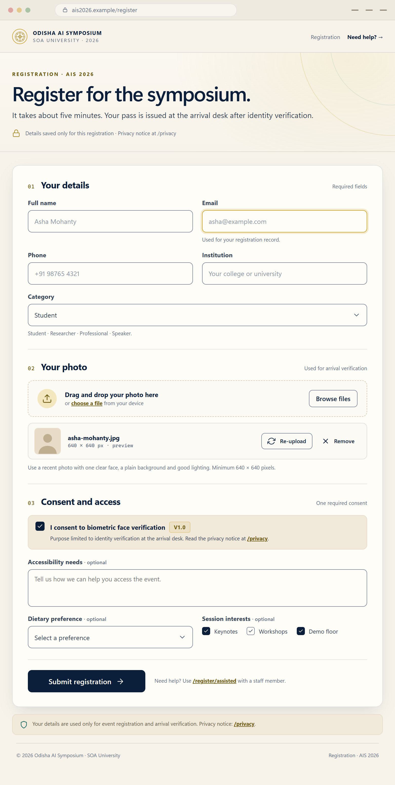
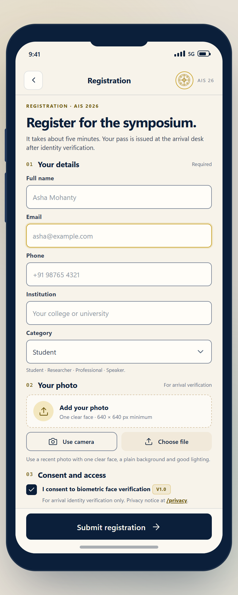
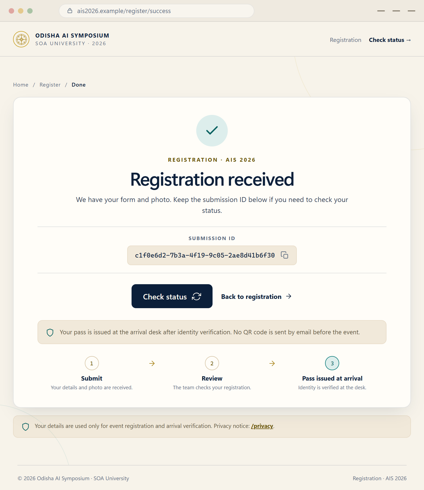

# GeekAI — Registration Redesign Plan

**Odisha AI Symposium 2026** · Frontend-only companion to [FrontendPlanning.md](FrontendPlanning.md), [React-Registration-Planning.md](React-Registration-Planning.md) and [WorkFlow.md](WorkFlow.md)
**Status:** Implemented and verified · 20 November 2026 · branch `debdatta/development` · commits `7ded722`, `aa2e741`, `a9be768`, `75cc9f9`

> **Scope:** This document plans one focused change — replacing the `/register` Google Form handoff with a first-party React form. It does not rewrite the nine existing planning files, and it touches no backend, database, infrastructure, Docker, ML or deployment code. Where a planning file appears inaccurate, the discrepancy is listed in §9 instead of being silently corrected.

---

## 1. Current-state delta

| | Before | After |
|---|---|---|
| Public intake | Google Form handoff (`ActionLink` to `event.registration.formUrl`) | Real in-site form posting to `POST /api/register` |
| Fields shown | None on-page (list only) | All 10 fields from React-Registration-Planning.md §2.1 |
| Validation | None client-side | On blur + on submit, field errors + error summary, focus-first-error |
| Photo | Not captured on `/register` | File picker + drag/drop + device camera, preview, remove/re-upload |
| Consent | Not captured on `/register` | Explicit versioned biometric checkbox, links to `/privacy` |
| Submit state | No form | Disabled button, progress state, double-submit guard |
| Success | N/A | Submission ID, status link, three-step explainer — no QR claim |
| Duplicate / closed / offline | Link-missing / closed banners | Designed panels/banners in the form itself |
| Assisted path | Separate `NativeRegisterForm` posting `/participants/` | Same form component with `source=WALK_IN` |
| Flags | `registrationHandoff` + `VITE_REGISTRATION_FORM_URL` | Both removed — one source of truth |

### Files changed by the implementation

| File | Change |
|---|---|
| `frontend/src/components/registration/RegistrationForm.jsx` | **New.** Presentation: sections, states, all primitives, sticky mobile CTA |
| `frontend/src/components/registration/PhotoUpload.jsx` | **New.** Drag/drop + picker + camera, preview, quality guidance |
| `frontend/src/lib/registration.js` | **New.** Field definitions, validation, payload builder, error map, draft persistence |
| `frontend/src/hooks/useRegistrationForm.js` | **New.** State, validation, submit, duplicate/offline states, focus management |
| `frontend/src/pages/Register.jsx` | Rewritten: real form, framing, closed state, explainer |
| `frontend/src/pages/AssistedRegistration.jsx` | Reuses `RegistrationForm assisted` |
| `frontend/src/components/ui/Field.jsx` | Explicit control id now wins over auto id (label/aria correctness) |
| `frontend/src/test/setup.js` | jsdom object-URL stub for photo preview |
| `frontend/src/content/flags.js`, `content/event.js` | Handoff flag and form URL removed |
| `frontend/src/components/public/*`, `pages/Home.jsx`, `pages/Privacy.jsx`, `content/faq.js` | Stale "Google Form" copy corrected |
| `frontend/src/components/registration/NativeRegisterForm.jsx` | Removed (legacy second intake path) |
| `frontend/src/App.stage2.test.jsx`, `App.copyfreeze.test.jsx`, `components/registration/RegistrationForm.test.jsx` | Tests updated/added |

---

## 2. Component inventory and states

```
Register / AssistedRegistration (page)
└── RegistrationForm (shared)
    ├── Banner (offline, draft restored, assisted)
    ├── ErrorState (submit failure, retry)
    ├── Field + Input × 4, Field + Select × 1
    ├── PhotoUpload (picker / drag-drop / camera / preview / remove)
    ├── Checkbox (versioned consent), Textarea (accessibility), Select (dietary)
    ├── Checkbox group (session interests)
    ├── Skeleton (submitting)
    └── Success / Duplicate panels + StatusSteps + PrivacyStrip
```

| State | Behaviour |
|---|---|
| Form open | All required fields visible; no external navigation |
| Validation error | Field message + summary; focus moves to first error |
| Photo rejected | API reason mapped to a field error; re-upload keeps other fields |
| Submitting | Button `loading`, double-submit guard, progress region |
| Success | Submission ID, signed status link, arrival-pass explainer, no QR |
| Duplicate | "Already registered" panel + one-click status |
| Registration closed | Page-level banner and explanation; form not rendered |
| Offline | Warning banner; drafted text restored from localStorage; retry on submit |

---

## 3. Validation and API contract

- **Fields:** `full_name`, `email`, `phone`, `institution`, `category` required; `photo` and versioned `consent_biometric` required; `accessibility_needs`, `dietary_preference`, `session_interest` optional — exactly React-Registration-Planning.md §2.1.
- **Phone:** 10-digit Indian format or E.164; **email:** syntax + lowercase normalization.
- **Payload:** multipart `POST /api/register` with `source=SITE_FORM` (or `WALK_IN` for assisted), `submission_id`, `client_event_id`, `submitted_at`, photo file, JSON `consent` block, optional fields. No invented endpoints; no presigned-POST assumption in the client — the agreed multipart path is used.
- **Error codes:** all §5 codes mapped to actionable messages; photo codes (`NO_FACE`, `MULTIPLE_FACES`, `LOW_RESOLUTION`, `BLURRY`, `DARK`, `UPLOAD_*`, `MISSING_PHOTO`) focus the photo input.
- **Draft:** text fields saved to `localStorage` (debounced) and restored; `File` objects are deliberately not persisted — the banner says the photo must be selected again.

### Mockup 09 — desktop form



### Mockup 10 — mobile form



### Mockup 11 — success state



---

## 4. Migration of the old handoff

1. Removed `NativeRegisterForm` and every import of it; no second intake path remains.
2. Removed `flags.registrationHandoff`, `event.registration.formUrl` and `VITE_REGISTRATION_FORM_URL`.
3. Corrected stale "Google Form" copy in Home, MobileMenu, StepExplainer, FAQ, Accessibility and Privacy content.
4. `/registration/status` and `/ticket/:token` are untouched. The success/duplicate panels link to them; a signed `status_token` from the API produces `?token=…`.
5. `/register/assisted` keeps its staff-only route guard in `App.jsx` and reuses the same form with `source=WALK_IN`.

---

## 5. Responsive and accessibility checklist

- [x] 760px form column, centered; single column on small screens
- [x] 16px inputs, 44px touch targets (design-system primitives)
- [x] Sticky 44px submit CTA on mobile with safe-area padding
- [x] Keyboard focus, visible focus rings, focus-first-error
- [x] `aria-live` error summary and status regions; `aria-invalid` via `Field`
- [x] Reduced motion respected globally; no horizontal scroll at 360px
- [x] WCAG 2.2 AA — verified by `App.a11y.test.jsx` (zero critical/serious axe violations)
- [x] Copy freeze — `App.copyfreeze.test.jsx` extended to permit truthful registration copy while still blocking false claims

---

## 6. Verification results (exact)

| Command | Result |
|---|---|
| `npm test` (from `frontend/`) | **142 passed / 142** (13 files; baseline was 135) |
| `npm run lint` | **0 errors**, 7 warnings — all pre-existing in untouched files |
| `npm run build` | Built in 6.43s; `Register` chunk 4.52 kB, `RegistrationForm` chunk 28.64 kB (9.30 kB gzip) |
| `node frontend/scripts/bundle-budget.mjs` | **All bundle budgets passed** (public 147.7 KB / 220 KB gzip; admin 146.7 KB / 300 KB) |

New tests cover: on-blur validation, submit summary + focus, success with submission ID and truthful copy, duplicate state, photo rejection preserving fields, assisted `WALK_IN` source, and the no-QR-emailed rule in every state.

---

## 7. Test updates

- `App.stage2.test.jsx`: "Stage 2 registration handoff" replaced with in-site form tests; no-form-URL test removed because the URL config no longer exists.
- `App.copyfreeze.test.jsx`: added an explicit truthful-copy test; forbidden-claim patterns unchanged.
- `components/registration/RegistrationForm.test.jsx`: new component-level suite (7 tests).

---

## 8. Open questions (carried forward, not invented answers)

1. Final closing date / capacity policy for the form (React-Registration-Planning.md §8.2).
2. Exact consent wording and retention period for `/register` and `/privacy` (§8.5).
3. Whether a signed status link is the only lookup path (§8.4).
4. Whether multipart upload remains the agreed contract long-term, or a presigned POST flow is introduced later — the client uses the current multipart contract only.

---

## 9. Status of earlier reported inaccuracies (all resolved)

- `Frontend-Redesign-Completion.md` and `frontend/STAGE5-QA.md` were updated in `75cc9f9` to describe the first-party form, the 143/143 test result and mockups 09–11.
- `WorkFlow-After-Frontend-Redesign.md` was updated in `a85906e` and `75cc9f9`; its plan-change note now records that the handoff was removed in `7ded722`.
- `React-Registration-Planning.md` §2.3 was corrected to multipart only; no presigned-POST endpoint is assumed.
- `FrontendPlanning.md` §7.2 already described the in-site form; the stale flag list in §11.2 and the "JSON plus photo upload" wording are corrected in this documentation pass.

The implementation is complete, following this plan, and no planning-document inaccuracy remains open.
